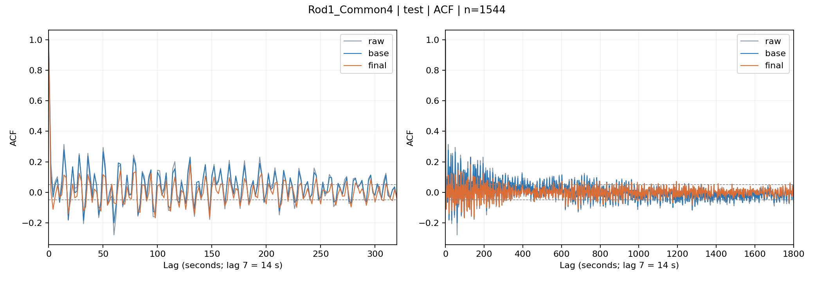
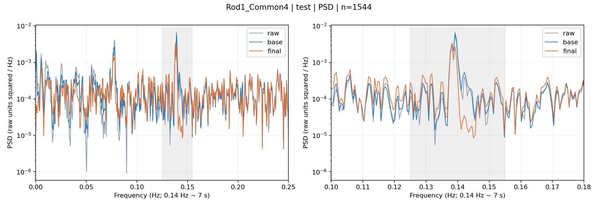
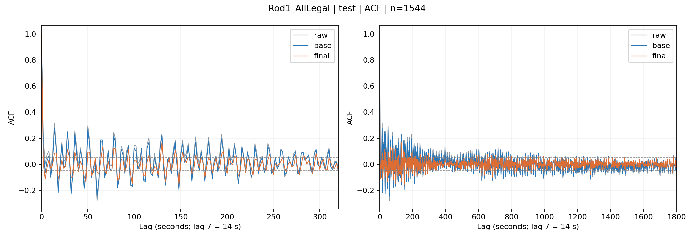
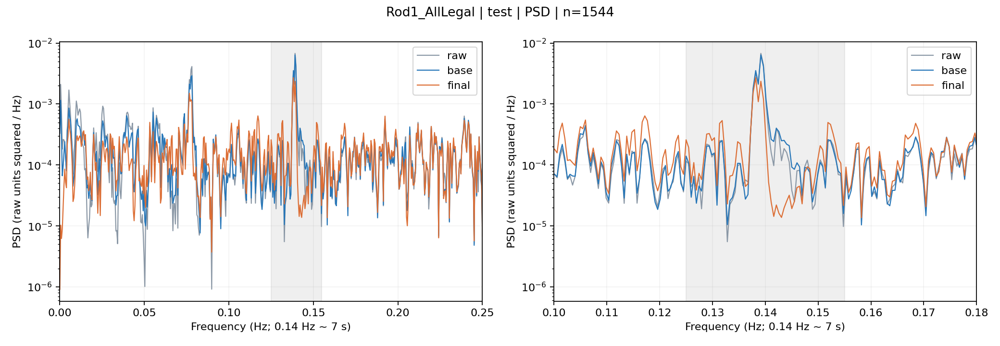
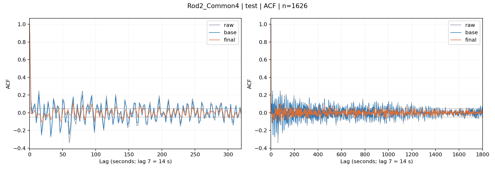
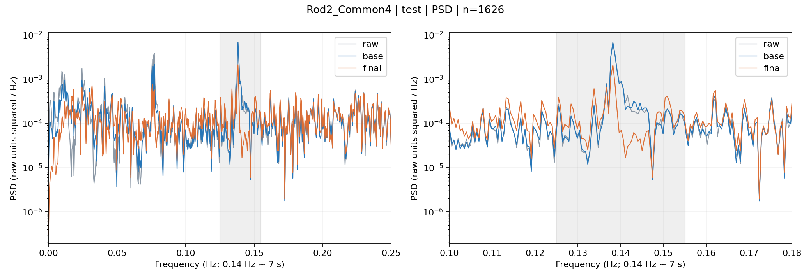

# CZ H1 轻量残差白化实验交付报告

分类：**POST_HOC_RESIDUAL_WHITENING_DIAGNOSTIC**。完成日期：2026-10-06（Asia/Shanghai）。两棒既往 test 已被观察；本轮时间尾段也是同一历史数据，不能称为新的确认性证据。

## 主要结论

普通 raw-history Ridge 后，三个 arm 都仍存在短周期残差相关。仅用成熟的过去残差作 correction，三者 RMSE、E160、E900、主要重复峰和固定 AR probe predictability 均改善。Rod2 改善更稳定；Rod1 validation 上的强降幅到 test 尾段有所回落，仍保留约 7 秒频谱结构。

Rod1 的额外合法变量**没有一致改善 base prediction**。AllLegal 在 validation/test 的 base RMSE 分别增加约 1.51%/1.96%；其 final test E160/E900 较 Common4 更低，但 validation 两项反而略高。这不足以认定遗漏 measured controls 是 Rod1 残余相关性的主因。结论更接近 **the remaining Rod1 dependence is unlikely to be explained by the additional measured controls under this simple history-window representation.** Regime/state dependence 是相容解释，未做机制识别，不能宣称已被证明。

## 数据、变量和划分

原始文件：`实验数据1-张.xlsx`，SHA-256 `c3428966fe006572809156ee5e3f488264b8206b19b20887dcd00840bb26fbc3`。Rod1 20103 行，Rod2 20627 行；采样周期沿用正式代码的 2 s，无时间戳独立校验。目标严格为 `D[t]-D[t-1]`，预测输入最晚 `t-1`。原始单位未提供，RMSE 使用原数值单位。分段沿用 Rod1 334/688/734，Rod2 745，不跨段建窗口。

原有正式 H1 是 cross-rod transfer，没有同棒独立 test；用户在本轮明确授权确定性修订：原 source-train membership 全部保留，原 source-validation 前半用于选参，中间 257 行隔离，余下尾段 descriptive test。该修订在训练前保存 `FROZEN_MEMBERSHIP.parquet` 和 `EXPERIMENT_PREREGISTRATION.json`，没有随机划分。旧 cross-rod test 不作为本轮 held-out 评分集。

| rod | train | validation | purged | test |
|---|---|---|---|---|
| Rod_1 | 15431 | 1800 | 257 | 1544 |
| Rod_2 | 16092 | 1883 | 257 | 1626 |

Rod1-only 原始字段为氩气流量设定、晶体长度、炉压。氩气流量设定为常数，虽保留于冻结清单，实际提供零方差信息。加热元件温度是两棒都有、Common4 未含的测量 context。AllLegal 冻结为 10 个通道：Common4 + 原晶升/埚升速度 + 温度 + 三个 Rod1-only 字段。

字段合法性沿用项目 record_time 约定：只使用已经记录的过去行。原工作簿没有独立延迟/离线回填元数据；特别是晶体长度按当时已记录的工艺状态处理，此可用性是假设而非外部认证。没有从直径构造任何 predictor。审计文件标明这一点。

joint_lift 原样提取正式 `cz_l256_nowcast.py` 的数据函数：仅在当前 fit 的 L 步历史行去重集合上标准化两种升速、取 PC1、固定晶升 loading 非负；每个 train-CV / OOF fit 重新拟合。候选 PCA 的 history extent 随 L 变化，复用 composite 定义，不复用全数据拟合状态。

## 选择、OOF 和在线使用

base 每 arm 6 histories × 5 alpha；每 L 通过 4 个 expanding prequential score blocks 选 alpha（前 1/5 为初始 fit，其后四段依次评分）。再用 validation RMSE 选 L；距最小值 0.1% 内取较短 L。每个 score block 的 target 不进入自己的 fit，索引有严格前后顺序。预处理仅拟合相应 training rows。

确定 recipe 后，同一 4-block prequential 过程只 refit 参数，得到 base OOF residual。A 每 arm 6 H × 5 alpha，全部仅拟合完整过去 H 个 OOF residual，用在线冷启动 validation RMSE 选择 H/alpha；0.1% 近似并列优先短 H，再较强 alpha。A 不读取 raw controls，不使用 in-sample base residual，不填不存在的 residual。

validation/test 每个连续段 residual state 清空，前 H 行 correction=0。每个 t 先预测，再在 y_t 成熟后加入 base residual，下一 t 才可用。缺行也清空。base/A 的 test 均加载冻结的 source-train / trainOOF 模型，未用 validation refit；两棒 test target 构造各一次，三 arm 配置及 probes 全冻结后才评分。Schema audit 按要求观察全表字段统计，但 test target/metrics 未用于选择。

这是普通 prequential OOF，base recipe 已经条件于开发期选择；没有 recursive nested-OOF，也不声称该条件选择等于完整嵌套验证。

| arm | L samples / seconds | base alpha | A H samples / seconds | A alpha |
|---|---|---|---|---|
| Rod1_Common4 | 64 / 128 | 1.0 | 96 / 192 | 100.0 |
| Rod1_AllLegal | 128 / 256 | 100.0 | 64 / 128 | 100.0 |
| Rod2_Common4 | 128 / 256 | 100.0 | 96 / 192 | 100.0 |

Rod1_Common4 最小 validation RMSE 的 L 是 128，但 L64 的损失在预注册 0.1% 并列范围内，故最终 L64。

## 预测与白化结果

以下为所有 scored rows，包含 A 冷启动。

| arm | split | RMSE base → final | RMSE降幅 | E160 base → final | E160降幅 | E900 base → final | E900降幅 |
|---|---|---|---|---|---|---|---|
| Rod1_Common4 | validation | 0.00736274 → 0.00656229 | 10.87% | 2.0218 → 0.2253 | 88.86% | 2.9652 → 0.5168 | 82.57% |
| Rod1_AllLegal | validation | 0.00747362 → 0.00656327 | 12.18% | 1.9542 → 0.2309 | 88.18% | 2.8029 → 0.5233 | 81.33% |
| Rod2_Common4 | validation | 0.00672456 → 0.00612766 | 8.88% | 1.7200 → 0.3575 | 79.21% | 3.3995 → 0.9638 | 71.65% |
| Rod1_Common4 | test | 0.00718357 → 0.00660583 | 8.04% | 1.6285 → 0.7970 | 51.06% | 2.9288 → 1.4385 | 50.88% |
| Rod1_AllLegal | test | 0.00732449 → 0.00658421 | 10.11% | 1.7970 → 0.6218 | 65.40% | 3.0674 → 1.1361 | 62.96% |
| Rod2_Common4 | test | 0.00674581 → 0.00624334 | 7.45% | 1.4798 → 0.3005 | 79.69% | 3.0586 → 0.7393 | 75.83% |

MAE、bias 及 raw target 层见 `METRICS_ALL_ARMS.csv`。Raw 层的 RMSE/MAE 是相对零变化 baseline，bias 是目标均值。最终三 arm 在 validation/test 的 MAE 与绝对 bias 均比各自 base 更低。

Rod1 AllLegal 相对 Common4 的变化（正数为指标下降、负数为指标上升）：

| split | stage | RMSE improvement | E160 improvement | E900 improvement |
|---|---|---|---|---|
| validation | base | -1.51% | 3.34% | 5.47% |
| validation | final | -0.01% | -2.50% | -1.26% |
| test | base | -1.96% | -10.35% | -4.73% |
| test | final | 0.33% | 21.98% | 21.03% |

## 重复峰和频谱

ACF lag7 是 14 s，lag14 是 28 s；约 0.14 Hz 的 Welch 峰代表约 7 s，二者没有混用。

| arm | split | lag1 base → final | lag7 base → final | lag14 base → final |
|---|---|---|---|---|
| Rod1_Common4 | validation | 0.0908 → -0.0127 | 0.2674 → 0.0501 | 0.2541 → 0.0258 |
| Rod1_AllLegal | validation | 0.0997 → -0.0180 | 0.2722 → 0.0346 | 0.2541 → 0.0235 |
| Rod2_Common4 | validation | 0.0776 → -0.0224 | 0.2863 → 0.0196 | 0.1877 → 0.0322 |
| Rod1_Common4 | test | 0.1220 → 0.0128 | 0.2769 → 0.1134 | 0.2430 → 0.1242 |
| Rod1_AllLegal | test | 0.1085 → 0.0026 | 0.2752 → 0.0855 | 0.2423 → 0.1123 |
| Rod2_Common4 | test | 0.0771 → -0.0125 | 0.2076 → -0.0111 | 0.1109 → -0.0364 |

| arm | split | dominant Hz | period s | 最大峰 PSD 降幅（峰位置可变） | 0.125–0.155Hz能量降幅 | 低频(0,0.02]Hz能量 |
|---|---|---|---|---|---|---|
| Rod1_Common4 | validation | 0.140137 → 0.140137 | 7.136 → 7.136 | 83.8% | 50.1% | 3.54e-06 → 2.41e-06 |
| Rod1_AllLegal | validation | 0.140137 → 0.140137 | 7.136 → 7.136 | 83.6% | 51.6% | 4.22e-06 → 2.31e-06 |
| Rod2_Common4 | validation | 0.137695 → 0.137695 | 7.262 → 7.262 | 58.9% | 54.3% | 5.05e-06 → 1.62e-06 |
| Rod1_Common4 | test | 0.139160 → 0.138184 | 7.186 → 7.237 | 42.5% | 27.0% | 5.84e-06 → 3.44e-06 |
| Rod1_AllLegal | test | 0.139160 → 0.138184 | 7.186 → 7.237 | 57.7% | 36.7% | 5.28e-06 → 3.21e-06 |
| Rod2_Common4 | test | 0.138184 → 0.138184 | 7.237 → 7.237 | 68.6% | 50.7% | 4.9e-06 → 2.3e-06 |

~0.14 Hz 附近结构减弱，但 final 的最强峰仍在该频带。Welch 固定 fs=0.5Hz、nperseg=1024、noverlap=512，Nyquist=0.25Hz。各段仅有两个 Welch 窗口，频谱峰位置和幅度的不确定性不可忽视；没有根据 test 改变窗宽或频带。

最强 ACF local peaks（按绝对值排序，test，展示前三个；更多及 PSD peaks 见 `TOP_PEAKS.csv`）：

| arm | stage | rank | lag samples | lag seconds | ACF |
|---|---|---|---|---|---|
| Rod1_Common4 | raw | 1 | 7 | 14 | 0.3140 |
| Rod1_Common4 | raw | 2 | 25 | 50 | 0.2944 |
| Rod1_Common4 | raw | 3 | 30 | 60 | -0.2796 |
| Rod1_Common4 | base | 1 | 7 | 14 | 0.2769 |
| Rod1_Common4 | base | 2 | 25 | 50 | 0.2644 |
| Rod1_Common4 | base | 3 | 14 | 28 | 0.2430 |
| Rod1_Common4 | final | 1 | 65 | 130 | 0.1816 |
| Rod1_Common4 | final | 2 | 49 | 98 | -0.1680 |
| Rod1_Common4 | final | 3 | 74 | 148 | -0.1648 |
| Rod1_AllLegal | raw | 1 | 7 | 14 | 0.3140 |
| Rod1_AllLegal | raw | 2 | 25 | 50 | 0.2944 |
| Rod1_AllLegal | raw | 3 | 30 | 60 | -0.2796 |
| Rod1_AllLegal | base | 1 | 7 | 14 | 0.2752 |
| Rod1_AllLegal | base | 2 | 25 | 50 | 0.2650 |
| Rod1_AllLegal | base | 3 | 30 | 60 | -0.2463 |
| Rod1_AllLegal | final | 1 | 65 | 130 | 0.1678 |
| Rod1_AllLegal | final | 2 | 74 | 148 | -0.1557 |
| Rod1_AllLegal | final | 3 | 49 | 98 | -0.1510 |
| Rod2_Common4 | raw | 1 | 30 | 60 | -0.3410 |
| Rod2_Common4 | raw | 2 | 16 | 32 | -0.2754 |
| Rod2_Common4 | raw | 3 | 7 | 14 | 0.2489 |
| Rod2_Common4 | base | 1 | 16 | 32 | -0.2624 |
| Rod2_Common4 | base | 2 | 9 | 18 | -0.2516 |
| Rod2_Common4 | base | 3 | 30 | 60 | -0.2450 |
| Rod2_Common4 | final | 1 | 33 | 66 | 0.1115 |
| Rod2_Common4 | final | 2 | 24 | 48 | -0.1046 |
| Rod2_Common4 | final | 3 | 10 | 20 | -0.1029 |

## Held-out residual predictability

预注册固定 Ridge AR probe：H=32、alpha=1。Base probe 只拟合 base OOF；final probe 只拟合第二次普通 prequential A prediction 得到的 final residual，避免使用 A 拟合内误差。第二次 prequential 每个 score block 也清空 state；recipe 固定，不再搜索。Probe evaluation 同样为空 state，输入只为该 residual 的过去。下表为 full probe-history 行，all-row 冷启动结果也在 CSV。R² 使用 held-out target centered SST；mean baseline 使用训练残差均值。负 R² 不表示证明独立，只表示该固定 probe 没有可迁移增益。

| arm | split | probe R² base → final | RMSE改善vs zero base → final | RMSE改善vs train mean base → final |
|---|---|---|---|---|
| Rod1_Common4 | validation | 0.1938 → 0.0073 | 10.40% → 0.40% | 15.07% → 0.61% |
| Rod1_AllLegal | validation | 0.2015 → -0.0050 | 11.90% → -0.25% | 10.77% → -0.21% |
| Rod2_Common4 | validation | 0.1412 → -0.0323 | 7.34% → -1.60% | 14.30% → -1.04% |
| Rod1_Common4 | test | 0.1489 → 0.0343 | 8.09% → 1.75% | 13.55% → 1.91% |
| Rod1_AllLegal | test | 0.1448 → 0.0190 | 9.51% → 0.95% | 7.54% → 0.99% |
| Rod2_Common4 | test | 0.1117 → -0.0588 | 5.89% → -2.90% | 11.61% → -2.31% |

## 16 个问题的明确回答

1. **Rod1_Common4 最终 L=64 samples=128 s**（0.1% 近似并列优先短 history）。
2. **Rod1_AllLegal L=128 samples=256 s**。
3. **Rod2_Common4 L=128 samples=256 s**。
4. **确实多出三字段**：氩气流量设定、晶体长度、炉压；首项为常数，三者均按 record_time past-only 使用，availability 条件见审计。
5. **未改善 base prediction**：validation/test RMSE 分别恶化约 1.51%/1.96%。
6. **E160 没有一致改善**：AllLegal 相对 Common4，base validation 降低 3.34%、test 升高 10.35%；final validation 升高 2.50%、test 降低 21.98%。
7. **E900 没有一致改善**：base validation 降低 5.47%、test 升高 4.73%；final validation 升高 1.26%、test 降低 21.03%。
8. **Rod1_Common4 correction**：validation E160/E900 下降 88.86%/82.57%；test 下降 51.06%/50.88%。
9. **Rod1_AllLegal correction**：validation E160/E900 下降 88.18%/81.33%；test 下降 65.40%/62.96%。
10. **Rod2_Common4 correction**：validation E160/E900 下降 79.21%/71.65%；test 下降 79.69%/75.83%。
11. **lag7/lag14 均明显减弱**；Rod1 test 仍保留约 0.09–0.12 的相关，Rod2 test 变为 -0.011/-0.036。
12. **~0.14Hz 结构减弱但未消失**：test 频带能量下降约 27.0%/36.7%/50.7%（Common4/AllLegal/Rod2；以频谱表精确值为准），最大峰仍在约 7.2s 附近。
13. **固定 probe 的 predictability 下降**：三 arm test R² 从约 0.149/0.145/0.112 降至 0.034/0.019/-0.059。
14. **本轮没有 arm 出现 correction 使 RMSE 改善而 E160/E900 恶化**。AllLegal 对 Common4 的验证期比较则存在 final RMSE 近似不变、白化略差，但不是稳定的 prediction gain。
15. **更像尚未捕获的 regime/state dependence，而非已测控制遗漏的主要解释**；这是有限表示下的诊断判断，不能从两棒单次尾段比较确认机制。AllLegal test 白化有所改善，但没有 validation/base 上一致证据支持“遗漏 observed-controls 是主因”。
16. **主实验 runner wall time 34.28s**（包含冻结、拟合、test评分、诊断及12张图）。从请求附件创建至报告生成的任务交付 wall time 约 **17.26分钟**，包含数据/协议核对、依赖准备、实现、验证和报告；此起点是请求到达的近似代理。审计输出目录创建至模型完成 348.95s。

## 判断、解释边界与交付

| arm | 判定 | 依据 |
|---|---|---|
| Rod1_Common4 | MODERATE_WHITENING_IMPROVEMENT | test E160/E900约下降51%/51%，RMSE降低8%，probe下降；validation→test退化及残余峰明显 |
| Rod1_AllLegal | MODERATE_WHITENING_IMPROVEMENT | test E160/E900约下降65%/63%，RMSE降低10%，probe下降；额外变量对Common4的优势仅见test，validation无一致优势 |
| Rod2_Common4 | STRONG_WHITENING_IMPROVEMENT | validation/test E160约下降79%/80%、E900约下降72%/76%，RMSE改善，lag7/14和probe显著减弱 |

这些类别是描述性证据判断，不是显著性门槛或白噪声认证。E900 的最高 lag900=1800s，而 test 仅约51/54分钟，最高 lag 仅644/726对；长 lag 不确定性较大。使用 centered biased ACF（分母全段 lag0能量）而非逐 lag 无偏估计，统计口径在训练前固定。Pointwise 95% band 仅图示，无多重比较控制；没有要求所有 lags 入区间，也没有用 Ljung-Box 作为通过标准。两个 rod 的 test 处于不同生长尾段，不能把棒间差异全部归因于控制信息。

独立验证通过：冻结文件与模型哈希一致；原 train membership 完全一致；OOF fit_end 早于 score；saved-model prediction 完整重放；扰动当前/未来控制不影响当前/过去预测，扰动当前/未来 residual 不影响当前/过去 A 输出；全部冷启动行无 correction；直接相关计算与 FFT ACF 一致；独立 sklearn SVD Ridge（含常数和共线性）与批量 Gram 解差异约 1e-15。详见 `VERIFICATION.json`。

所有必需 CSV/JSON/parquet、训练前冻结、源代码、日志、模型 NPZ 和额外频谱摘要均保存在本目录。没有 import 或运行 recursive K/C/W/A runner；没有修改原实验、原工作簿或历史模型。复现命令：在新的空输出目录中放置三份 `.py`，先运行 `audit_and_data.py`，再 `run_experiment.py`，最后 `verify_and_report.py`；原目录有 freeze 文件时 runner 拒绝覆写。

### Rod1_Common4 descriptive test 图

### Rod1_AllLegal descriptive test 图

### Rod2_Common4 descriptive test 图

