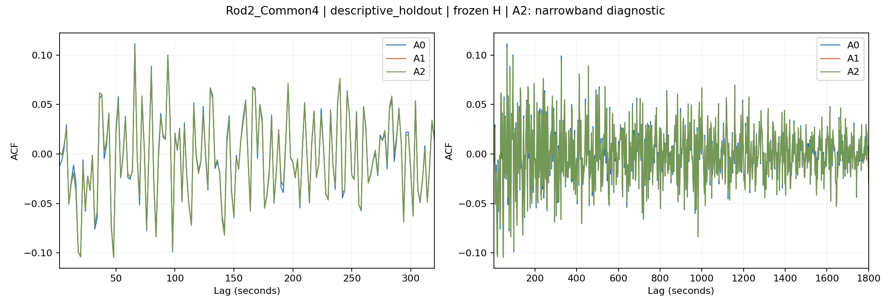
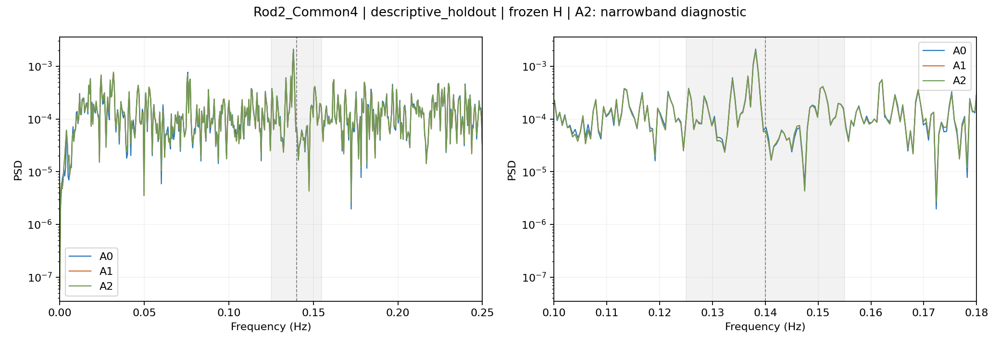
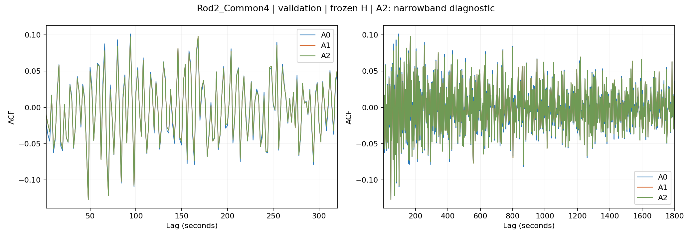
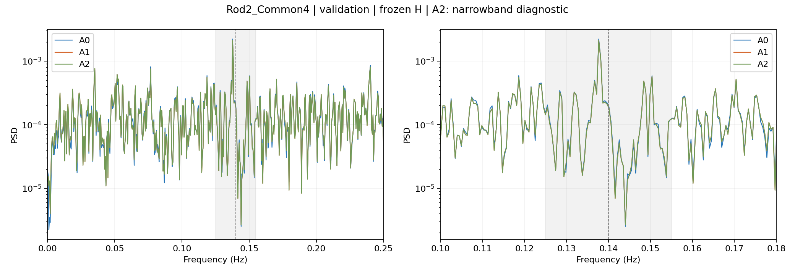

# CZ H1 7 秒短周期残差修正实验

完成日期：2026-10-06（Asia/Shanghai）。分类：POST_HOC_DESCRIPTIVE_DIAGNOSTIC。旧test和周期峰已被查看，本轮继续使用原descriptive holdout，不能称作独立确认性检验。

## 结论

**NO_ADDITIONAL_SHORT_CYCLE_GAIN；推荐继续使用 A0。**

该标签指未达到预注册的“明显压峰”成功标准，**不是观察到零增益**。Rod2 A1有小幅、可迁移的改善：validation/holdout注册频带能量下降约3.78%/3.70%，RMSE改善0.24%/0.32%，E160/E900均略降。但最大残余谱峰仍存在，部分lag绝对相关反而增加，bias也更大。A2相对A1几乎重合，没有额外主收益。

按“Rod2成功后才复制”的条件，Rod2未达到validation复制门槛，**没有运行Rod1_Common4或Rod1_AllLegal**。未增加候选、改变频带或继续复杂调参。

## 冻结复用与实验协议

完整复用 `cz_h1_light_whitening_20261006` 的冻结membership、base history/alpha/scaler/model、train prequential OOF residual和validation/holdout base pointwise。没有打开原工作簿，没有读取控制变量，没有重训base或运行base history search，更没有K/C/W、Urysohn、recursive nested-OOF。所有源文件及模型hash在结束时保持一致。

Rod2主比较固定 **H=96 samples=192s**；A0为旧alpha=100的原模型和原scaler，直接加载，逐行复现旧final prediction/residual。A1/A2的alpha只能从 `{1e-4,1e-2,1,100}` 依据tuning-validation冷启动RMSE选择，本轮均选100。H `{32,64,96}` 仅作小范围validation敏感性检查，三个模型的最佳敏感性H也均为96；这些结果没有用来替换主H，其他H没有打开holdout评分。

A1表示在本轮训练前固定为：完整96个raw residual lags + 固定短周期lags `{1,2,3,4,5,7,8}` 上的四类变换（sign、absolute magnitude、first difference、zero crossing），共124维。固定短block已有raw列，不重复添加。Diff/zero-crossing需要k+1≤9，仍在相同96个成熟残差内；没有使用H+1或current residual。这一实现是“full raw history + very-small transformed short block”，没有额外尝试给全部96个lag添加非线性变换；结果只适用于此次冻结表示。

A2=A1+两个预注册harmonic columns，126维；f0固定0.14Hz、dt=2s。`c=sum r(t-k)cos(2πf0kdt)`、`s=sum r(t-k)sin(2πf0kdt)`。它只作diagnostic，未追踪或拟合holdout峰频。

**A2的两个feature是已存在raw lags的线性组合**，没有增加新的观测信息或线性函数空间；在标准化Ridge中它们通过冗余列改变正则化几何，才可能带来窄带先验收益。因此“harmonic未收益”不等于排除周期，也不等于0.14Hz没有可预测结构。A1中的diff也属于线性组合；sign/magnitude/zero-crossing才提供不同的非线性表示。

A1/A2拟合只使用已有train OOF base residual，丢弃前H行不完整history，fit scaler仅在这些trainOOF特征上拟合。Validation/holdout分别清空state，首96行correction=0，特征先构造、当前base residual成熟后才加入state；实体或origin中断则再次清空。三个模型均评分相同原始rows：validation1883、holdout1626，主结果包含相同冷启动96行。

固定probe仍是H32、alpha1。A0复用上一轮saved final-residual probe；A1/A2 probes只拟合另一次普通prequential fixed-recipe A prediction得到的训练final residual，没有用A in-sample误差。Probe的scaler同样train-only。没有重选probe H/alpha，也不按probe结果选择A。

## 成功与复制门槛

用户规定band明显下降、E160/E900不恶化、RMSE恶化不超过0.5%；本轮在训练前将“明显”操作化为**频带能量至少下降10%**。10%是本轮自行预注册的诊断阈值，并非用户指定数值；它不代表统计显著性。完整成功要求validation与holdout都满足三项。复制门槛只看Rod2 validation：A1或A2相对A0满足上述条件才依原样协议发展Rod1，避免让holdout控制候选/模型选择。

A1在validation上band降幅仅3.78%，因此未过门槛；A2仅3.71%，同样未过。该判断在读取本轮holdout pointwise前已冻结。`GLOBAL_SELECTION_FREEZE.json` 保存三个主模型和probe hashes；随后仅打开一次旧POINTWISE_TEST.parquet用于descriptive scoring。

## 预测与白化指标

| split | model | RMSE | MAE | bias | E160 | E900 | band power | nearest0.14 PSD |
|---|---|---|---|---|---|---|---|---|
| validation | A0 | 0.006127661 | 0.004921145 | -0.000018207 | 0.357518 | 0.963824 | 5.45126379e-06 | 0.000189347308 |
| validation | A1 | 0.006112830 | 0.004909480 | -0.000228719 | 0.334212 | 0.918796 | 5.24520727e-06 | 0.000181370127 |
| validation | A2 | 0.006113064 | 0.004909682 | -0.000228704 | 0.334849 | 0.920124 | 5.24909571e-06 | 0.000180908603 |
| descriptive_holdout | A0 | 0.006243343 | 0.005040237 | 0.000009645 | 0.300530 | 0.739339 | 5.97925476e-06 | 6.91730346e-05 |
| descriptive_holdout | A1 | 0.006223545 | 0.005028619 | -0.000224580 | 0.291824 | 0.727151 | 5.7582599e-06 | 6.01844607e-05 |
| descriptive_holdout | A2 | 0.006223785 | 0.005028816 | -0.000224562 | 0.292251 | 0.727883 | 5.76300547e-06 | 6.00009999e-05 |

相对A0，正值表示指标下降/改善：

| split | comparison | RMSE下降 | E160下降 | E900下降 | band下降 | nearest-bin PSD下降 | dominant PSD下降 |
|---|---|---|---|---|---|---|---|
| validation | A1_vs_A0 | 0.242% | 6.519% | 4.672% | 3.780% | 4.213% | 5.431% |
| validation | A2_vs_A0 | 0.238% | 6.340% | 4.534% | 3.709% | 4.457% | 5.271% |
| descriptive_holdout | A1_vs_A0 | 0.317% | 2.897% | 1.648% | 3.696% | 12.994% | 5.629% |
| descriptive_holdout | A2_vs_A0 | 0.313% | 2.755% | 1.549% | 3.617% | 13.260% | 5.459% |

三模型dominant peak位置相同：validation0.137695Hz（7.262s），holdout0.138184Hz（7.237s）。Nearest-bin-to-0.14是0.140137Hz，不是上述dominant bin；holdout nearest-bin降低约13%不能替代整体band仅降3.7%的事实。Welch参数与旧报告相同：fs0.5、nperseg1024、noverlap512。尾段只有两个Welch averages，谱估计噪声和E900长lag不确定性依然存在。

A1绝对bias由约1e-5/1.8e-5升至约2.25e-4/2.29e-4。RMSE仍略有改善，但增加的bias也是谨慎保留A0的理由；没有按此结果修改intercept或增加校准步骤。

## lag3/4/7/14

| split | model | rho3 | rho4 | rho7 | rho14 |
|---|---|---|---|---|---|
| validation | A0 | -0.046486 | 0.017047 | 0.019588 | 0.032244 |
| validation | A1 | -0.033877 | 0.016476 | 0.015767 | 0.030232 |
| validation | A2 | -0.033819 | 0.016578 | 0.015881 | 0.030273 |
| descriptive_holdout | A0 | 0.005480 | 0.029645 | -0.011081 | -0.036398 |
| descriptive_holdout | A1 | 0.008937 | 0.026361 | -0.019048 | -0.037015 |
| descriptive_holdout | A2 | 0.008993 | 0.026453 | -0.018947 | -0.036973 |

Validation A1在四个指定lag的绝对相关均下降；holdout仅lag4从0.02965降到0.02636，lag3从0.00548升到0.00894、lag7从-0.01108变为-0.01905、lag14从-0.03640变为-0.03702，后面三项的绝对值增加。E160/E900整体仍下降，说明局部峰改善并不一致。Lag3/4对应6/8s，lag7/14对应14/28s，不等于约0.14Hz频谱周期。

## 固定residual-predictability probe

| split | model | mature rows | R² | probe RMSE | improvement vs zero | improvement vs train mean |
|---|---|---|---|---|---|---|
| validation | A0 | 1851 | -0.032303 | 0.006238282 | -1.602% | -1.044% |
| descriptive_holdout | A0 | 1594 | -0.058769 | 0.006406596 | -2.896% | -2.307% |
| validation | A1 | 1851 | -0.056528 | 0.006291083 | -2.714% | -1.374% |
| descriptive_holdout | A1 | 1594 | -0.082047 | 0.006450982 | -3.947% | -2.633% |
| validation | A2 | 1851 | -0.056441 | 0.006291071 | -2.710% | -1.367% |
| descriptive_holdout | A2 | 1594 | -0.081984 | 0.006451050 | -3.944% | -2.627% |

各probe在held-out均为负R²，表示固定AR probe没有可迁移的预测收益；A1/A2更负，不能机械解释为“更白”。分布偏移、bias及probe fit差异也影响R²。All-row cold-start结果见CSV，未用probe判断重选模型或证明innovation。

## A2及history敏感性

| split | A2 RMSE下降vsA1 | E160下降 | E900下降 | band下降 | nearest PSD下降 |
|---|---|---|---|---|---|
| validation | -0.0038% | -0.1906% | -0.1445% | -0.0741% | 0.2545% |
| descriptive_holdout | -0.0039% | -0.1463% | -0.1007% | -0.0824% | 0.3048% |

A2比A1的RMSE略差约0.0038%，band energy略高约0.07–0.08%，没有额外有效压峰。Nearest0.14 bin虽然再小降约0.25–0.30%，但全band与综合指标没有收益；不裁定NARROWBAND_PRIOR_DIAGNOSTIC_ONLY。

| model | H | selected alpha | validation RMSE | sensitivity best H |
|---|---|---|---|---|
| A0 | 32 | 100 | 0.006233317 | False |
| A1 | 32 | 100 | 0.006201372 | False |
| A2 | 32 | 100 | 0.006201604 | False |
| A0 | 64 | 100 | 0.006147992 | False |
| A1 | 64 | 100 | 0.006127219 | False |
| A2 | 64 | 100 | 0.006127546 | False |
| A0 | 96 | 100 | 0.006127661 | True |
| A1 | 96 | 100 | 0.006112830 | True |
| A2 | 96 | 100 | 0.006113064 | True |

Sensitivity共3H×3models×4alphas=36个候选；不扩展history/alpha，不增加频率或feature搜索。

## 八个问题的明确回答

1. **A1小幅优于A0，但未达本轮明显改善门槛**；不是零增益，也没有主模型替换证据。
2. **0.125–0.155Hz band power下降3.780%（validation）、3.696%（holdout）**。
3. **E160/E900分别下降6.519%/4.672%（validation），2.897%/1.648%（holdout）**。
4. **指定lag不全改善**：validation四项绝对值均降；holdout仅lag4降，其余三项绝对值略增。
5. **RMSE没有恶化**：分别改善0.242%/0.317%，但bias增加。
6. **A2无额外综合收益**；两个harmonic为raw lags的线性组合，在本Ridge设定下仅改变正则化权重。
7. **小幅band/E/RMSE改善可从validation保持到holdout**，但幅度远小于初次A0对base的白化收益，局部lag和probe不支持强追加结论。
8. **推荐A0；A1保存作此次小幅表示敏感性结果，A2仅作diagnostic**。没有运行Rod1，停止追加调参。

## 解释边界、验证与交付

可以描述为：**remaining short-period residual dependence is predictable from mature residual history**，且本轮小规模非线性short block还能提取少量增益。不能宣称已确认传感器、晶转或真实物理状态。前次机制诊断裁定仍是UNRESOLVED_RESIDUAL_STATE，0.01记录格点明确但binary event timing证据不足；本轮没有改变该裁定。

独立验证通过：所有源文件/base/scaler hashes不变；A0逐行复现旧结果；三模型scoring row IDs、base prediction/residual完全相同；前H行均无correction；扰动当前/未来residual不影响当前/过去预测，当前/未来target不进入features；变换公式和harmonic线性关系正确；显式correlation与FFT ACF一致；独立sklearn SVD Ridge解与批量Gram解一致；probe训练块的fit_end严格早于scored origins。见 `VERIFICATION.json`。

主实验runner wall time **2.81s**；从请求附件创建到报告生成约 **12.34分钟**（起点为请求到达的近似代理），包含协议冻结、实现、核对与交付，未超过30分钟预算。

必需6个结果文件和Rod2 ACF/PSD图齐全；另提供validation图、probe CSV、训练probe prequential pointwise、冻结模型NPZ、preregistration、hashes、决策JSON、代码与日志。复现时在analysis_outputs下新的同级空目录放置两份py；执行run_experiment.py和verify_and_report.py。旧目录有freeze时拒绝覆写。

