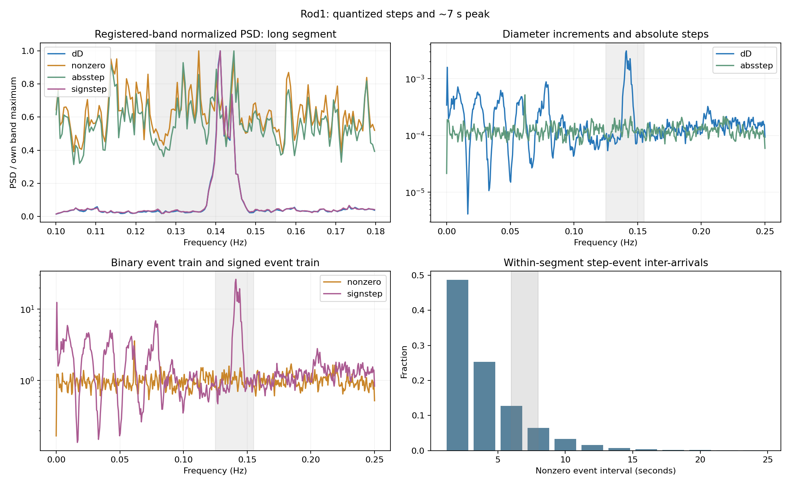
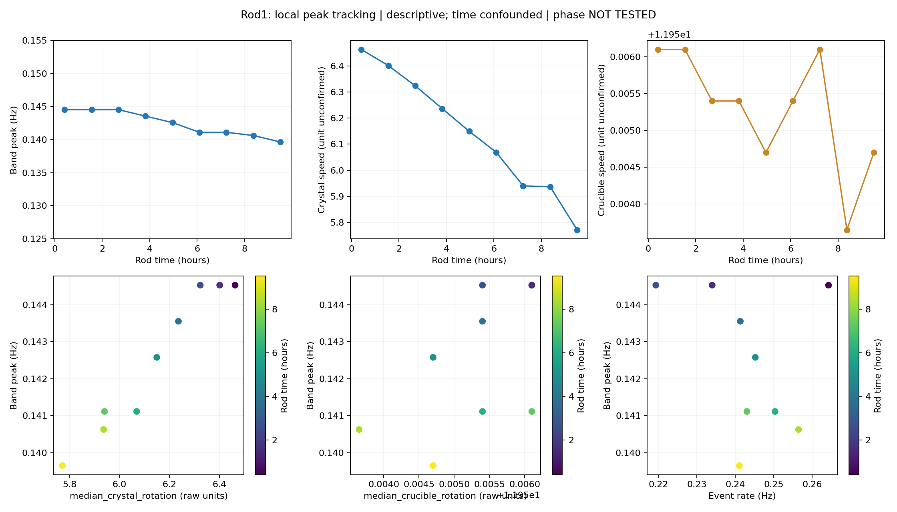
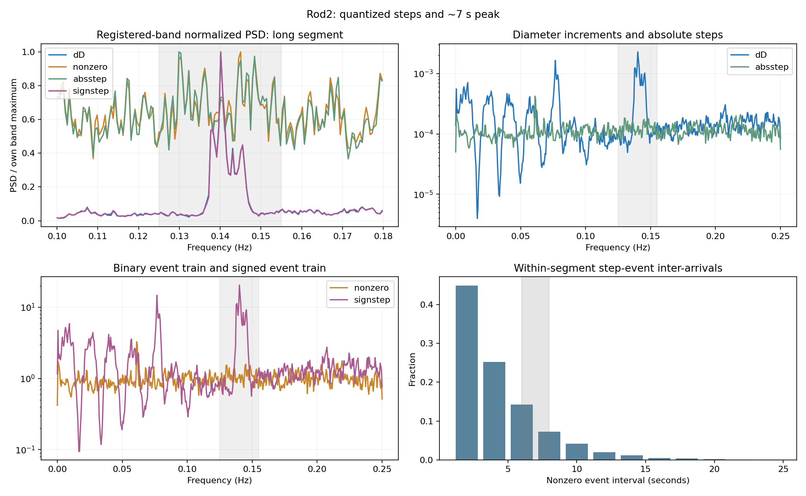
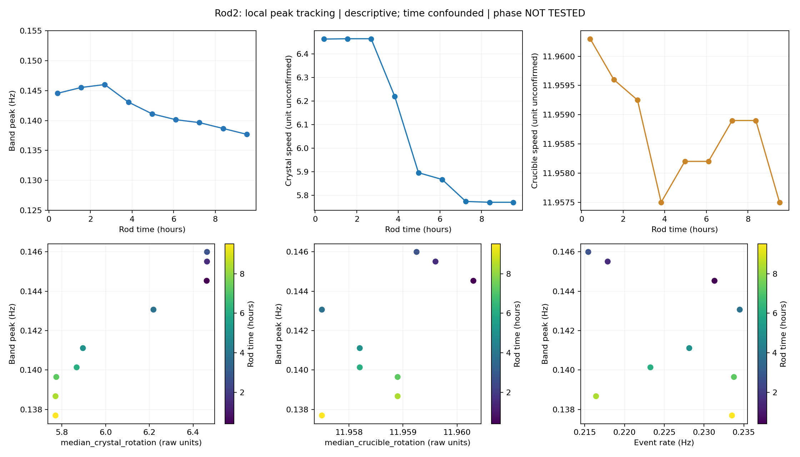

# CZ H1 约 7 秒短周期峰来源诊断报告

日期：2026-10-06（Asia/Shanghai）。纯诊断，**没有训练任何 PRISM、K/C/W/A、Urysohn 或 residual predictor**。既有模型只使用已保存 pointwise residual，不加载或重训 checkpoint。所有结论均为 post-hoc descriptive。

## 最终裁定

**D. UNRESOLVED_RESIDUAL_STATE**。

该标签表示“目前来源未解决”，不是证明隐藏状态，也不是排除旋转。H_Q 的关键 timing 条件未满足；H_R 有值得继续核对的双棒漂移线索，但单位无法确认，最关键的 rotation-phase held-out test **未执行**，不能当作负结果。既有 residual-history correction 能削弱峰，在当前 observables 下仍由 A 处理最合理。

**最有信息量的新发现：约 0.14 Hz 结构主要在带方向的直径变化序列中，而不是是否跨格的 binary event train。局部峰频率又与晶转速度明显同向漂移。** 因而“存在 0.01 记录格点”不足以解释该峰，机械/测量相位效应仍是合理候选。

## 数据、对齐和固定诊断参数

原始工作簿 `实验数据1-张.xlsx` 的 SHA-256 为 `c3428966fe006572809156ee5e3f488264b8206b19b20887dcd00840bb26fbc3`，与轻量实验一致。沿用 dt=2s、fs=0.5Hz、Nyquist=0.25Hz。Rod1 分段边界 334/688/734，Rod2 为745，segment 内独立差分、Welch、coherence 和 inter-arrival；从未拼接两段动态序列。静态计数允许汇总来自各段的已计算值，不生成跨边界间隔。

固定重点频带 **0.125–0.155Hz**，参考 bin 为最接近 0.138Hz。Welch nperseg=min(1024,n)、noverlap=floor(nperseg/2)，constant detrend，density scaling。长窗口分辨率 0.00048828125Hz。短段仅有一次平均时仍报告 PSD，coherence 留空并标记不可识别，因为单次 periodogram 的 MSC 会退化到1。

残差对齐使用已保存 entity/origin/global_origin：原始绝对行等于 segment_start+origin，逐行确认 y_true=D[origin]-D[origin-1]、base_residual=y_true-base_prediction，六组 validation/test 全部通过，误差 <1e-12。Coherence 主表使用同一行 t 的原始输入，另报 t-1 对齐的 base-residual coherence；前者是同期观测关联，不是预测因果证据。

局部 tracking 使用每段内不重叠2048 raw-row windows；剩余不足1536行的尾块不纳入。两棒各9块，导数每块2047点、3个 Welch 平均。另行报告既有 descriptive test 的尾段结果，未移动 band 或选择更好看的窗口。

## Diagnostic A：量化格点与跨格 timing

| rod | D unique | dD unique(raw float) | dD grid unique | dD=0 | 最大距0.01格点 | interval median sample/s | mode sample/s | 6–8s比例 | 同event-rate几何参考 |
|---|---|---|---|---|---|---|---|---|---|
| Rod_1 | 381 | 21 | 6 | 50.963% | 2.6855469e-05 | 2 / 4 | 1 / 2 | 19.25% | 19.23% |
| Rod_2 | 373 | 20 | 7 | 54.192% | 2.6855469e-05 | 2 / 4 | 1 / 2 | 21.50% | 20.74% |

所有 D 值距最近0.01格点都小于5e-5，最大偏差约2.69e-5；这是近似0.01 lattice，不能把二进制存储尾差当成21/20种物理 step sizes。部分数值与 float32 编码吻合，但不是所有值完全符合“round(D,2)再存float32”，因此不宣称已识别记录器编码流程。round 到0.01格点后 dD 有6/7种值。

非零 step sizes（各段静态计数汇总，主要三类）：

| rod | |dD| grid step | count | 占非零step比例 |
|---|---|---|---|
| Rod_1 | 0.01 | 9225 | 93.60% |
| Rod_1 | 0.02 | 618 | 6.27% |
| Rod_1 | 0.03 | 13 | 0.13% |
| Rod_2 | 0.01 | 9042 | 95.70% |
| Rod_2 | 0.02 | 401 | 4.24% |
| Rod_2 | 0.03 | 5 | 0.05% |

非零 event intervals 主要集中于1–2 samples（2–4s），呈快速递减分布。3–4 samples（6–8s）占约19.3%/21.5%，与对应事件发生率下的独立几何参考约19.2%/20.7%相近；没有在3–4 sample附近形成主峰。几何参考只作直观计数比较，未假设事件真的独立。完整 histogram 包含稀有长间隔，图只展示前12个sample间隔。

长段五种信号的频谱（D含明显生长趋势，因此global dominant是低频；完整各segment结果见CSV）：

| rod | signal | dominant Hz | period s | registered band power | band peak Hz | near0.138 peak/background | band-max permutation p |
|---|---|---|---|---|---|---|---|
| Rod_1 | D | 0.000488 | 2048.000 | 6.0316e-06 | 0.141113 | 29.90 | 1.000 |
| Rod_1 | dD | 0.141113 | 7.087 | 1.4558e-05 | 0.141113 | 30.53 | 0.005 |
| Rod_1 | nonzero | 0.061523 | 16.254 | 0.03054 | 0.135742 | 1.64 | 0.080 |
| Rod_1 | absstep | 0.061523 | 16.254 | 3.8892e-06 | 0.144531 | 1.64 | 0.010 |
| Rod_1 | signstep | 0.141113 | 7.087 | 0.12391 | 0.141113 | 28.67 | 0.005 |
| Rod_2 | D | 0.000488 | 2048.000 | 4.8665e-06 | 0.140137 | 21.54 | 1.000 |
| Rod_2 | dD | 0.140137 | 7.136 | 1.1662e-05 | 0.140137 | 22.39 | 0.005 |
| Rod_2 | nonzero | 0.061035 | 16.384 | 0.032981 | 0.145020 | 1.50 | 0.085 |
| Rod_2 | absstep | 0.061035 | 16.384 | 3.8276e-06 | 0.129883 | 1.50 | 0.095 |
| Rod_2 | signstep | 0.140137 | 7.136 | 0.10433 | 0.140137 | 22.47 | 0.005 |

“局部峰”指固定0.135–0.142Hz范围内的local maximum；峰/背景比用0.10–0.18Hz中预注册band以外的median PSD作为背景，≥3标记prominent。显著性辅助检验为长段内部199次随机排列、固定seed，比较整个注册频带的最大PSD（p最小0.005）。它检验temporal ordering相对exchangeability，不检验物理机制；未对所有信号做全局多重比较校正，D的强趋势也使这种全序列排列null不适合判断其高频谱峰缺失。

dD/signstep 的近0.14Hz峰约为邻域背景的22–31倍；nonzero/absstep在参考邻域约1.5–1.6倍。Rod1 absstep的全band-max permutation p=0.010对应其他较弱局部结构，不等于两棒稳定的0.138Hz step-event峰。两棒 nonzero 的全band p=0.080/0.085，最强全频峰反而约0.061Hz（~16.3s）。

A1. **没有看到 binary nonzero-step event train 本身稳定携带与 dD 同频的强约7s峰**。可以有弱local maxima，但位置和主峰不一致；不能把“存在任意local maximum”称为H_Q成立。

A2. **跨格没有以3–4 samples为主要间隔节律重复**；mode为1sample，median为2samples。

A3. **可变step amplitude不是主导；“无方向event timing”也不足以解释。** 固定成0.01×sign(dD)后保留了符号与发生时刻，仍携带同频强峰；这是方向序列的重要性，不能偷换成binary quantization timing成立。长段定幅signed-unit与dD相关约0.976/0.982，保留band能量约85.1%/89.5%。去掉step方向后峰明显弱化。此观察仍不能分辨：方向节律是实际物理运动、测量相位效应，还是记录过程与潜在输出状态的组合。

| rod | signal | local band peak与dD相距≤2 bins |
|---|---|---|
| Rod_1 | absstep | 1/9 |
| Rod_1 | nonzero | 2/9 |
| Rod_1 | signstep | 9/9 |
| Rod_2 | absstep | 2/9 |
| Rod_2 | nonzero | 2/9 |
| Rod_2 | signstep | 9/9 |

该定位容差仅为固定分辨率下的描述；nonzero/absstep多块不同频，signstep两棒9/9同频。

## Diagnostic B：输入PSD与coherence

长段 measured controls，coherence目标为同段dD；原始单位未知，PSD绝对数值不能直接跨变量比较：

| rod | channel | PSD band power | MSC nearest0.138 | band mean MSC | band max MSC | max Hz | Welch averages |
|---|---|---|---|---|---|---|---|
| Rod_1 | crystal_rotation | 9.8617e-07 | 0.0325 | 0.0242 | 0.0892 | 0.130859 | 36 |
| Rod_1 | crucible_rotation | 5.8672e-05 | 0.1489 | 0.0282 | 0.1489 | 0.138184 | 36 |
| Rod_1 | main_heater_power | 0.00045048 | 0.0294 | 0.0306 | 0.0986 | 0.144531 | 36 |
| Rod_1 | crystal_lift | 1.2987e-06 | 0.1259 | 0.0609 | 0.1917 | 0.146484 | 36 |
| Rod_1 | crucible_lift | 3.4165e-08 | 0.1142 | 0.0599 | 0.2715 | 0.141113 | 36 |
| Rod_1 | heater_temperature | 3.0085e-08 | 0.0085 | 0.0257 | 0.1154 | 0.130859 | 36 |
| Rod_2 | crystal_rotation | 8.5178e-07 | 0.0116 | 0.0303 | 0.1449 | 0.143066 | 37 |
| Rod_2 | crucible_rotation | 3.8569e-05 | 0.0002 | 0.0287 | 0.1130 | 0.139648 | 37 |
| Rod_2 | main_heater_power | 0.00036143 | 0.0291 | 0.0349 | 0.2331 | 0.125000 | 37 |
| Rod_2 | crystal_lift | 1.2185e-06 | 0.0654 | 0.0510 | 0.2485 | 0.137695 | 37 |
| Rod_2 | crucible_lift | 3.0363e-08 | 0.0638 | 0.0450 | 0.2221 | 0.137695 | 37 |
| Rod_2 | heater_temperature | 1.8214e-08 | 0.0125 | 0.0256 | 0.0814 | 0.143066 | 37 |

晶转速度在nearest0.138的MSC约0.033/0.012，没有稳定的双棒强线性speed→dD coherence。升速有部分频带关联；输入与输出均处于闭环、生长阶段漂移条件，不能按单个maximum做因果归属。窄带结构频率随时间变化也会压低整段coherence。**低speed coherence不能排除角相位驱动的测量效应**，恒定speed仍可持续旋转。

严格对齐的base-residual test coherence（同期t；完整validation及t-1在CSV）：

| arm | channel | nearest0.138 MSC | band mean | band max | max Hz | Welch averages |
|---|---|---|---|---|---|---|
| Rod1_Common4 | crystal_rotation | 0.937 | 0.580 | 0.962 | 0.129395 | 2 |
| Rod1_Common4 | crucible_rotation | 0.424 | 0.472 | 0.967 | 0.146973 | 2 |
| Rod1_Common4 | main_heater_power | 0.215 | 0.580 | 0.954 | 0.134277 | 2 |
| Rod1_Common4 | crystal_lift | 0.875 | 0.556 | 0.985 | 0.142578 | 2 |
| Rod1_Common4 | crucible_lift | 0.924 | 0.548 | 0.987 | 0.132812 | 2 |
| Rod1_Common4 | heater_temperature | 0.048 | 0.516 | 0.986 | 0.125488 | 2 |
| Rod1_AllLegal | crystal_rotation | 0.953 | 0.586 | 0.971 | 0.148926 | 2 |
| Rod1_AllLegal | crucible_rotation | 0.440 | 0.503 | 0.972 | 0.147949 | 2 |
| Rod1_AllLegal | main_heater_power | 0.244 | 0.544 | 0.989 | 0.142578 | 2 |
| Rod1_AllLegal | crystal_lift | 0.877 | 0.553 | 0.984 | 0.137695 | 2 |
| Rod1_AllLegal | crucible_lift | 0.931 | 0.539 | 0.971 | 0.149414 | 2 |
| Rod1_AllLegal | heater_temperature | 0.035 | 0.497 | 0.979 | 0.125488 | 2 |
| Rod2_Common4 | crystal_rotation | 0.356 | 0.468 | 0.994 | 0.133301 | 2 |
| Rod2_Common4 | crucible_rotation | 0.130 | 0.503 | 0.969 | 0.130371 | 2 |
| Rod2_Common4 | main_heater_power | 0.056 | 0.464 | 0.972 | 0.134766 | 2 |
| Rod2_Common4 | crystal_lift | 0.772 | 0.565 | 0.998 | 0.153320 | 2 |
| Rod2_Common4 | crucible_lift | 0.738 | 0.575 | 0.997 | 0.126953 | 2 |
| Rod2_Common4 | heater_temperature | 0.351 | 0.443 | 0.999 | 0.145996 | 2 |

尾段只有2个重叠Welch averages，MSC估计的噪声偏置很大。独立average假设下M=2的零coherence点95%阈值就为0.95，重叠/时间相关又使该公式不精确；更不能用对整个频带取最大值来声称显著。表中高值只能视为低精度描述，未用于机制裁定或模型选择。

## Diagnostic C/D：旋转单位与phase

**两种rotation单位UNCONFIRMED**；详见 `ROTATION_UNIT_AUDIT.md`。原始表头、comments、格式和CZ metadata无rpm/rev/s/rad/s证据。没有按常识假定rpm，没有做rpm/60、harmonic差值、angle积分或phase训练。`ROTATION_PHASE_HELDOUT.csv` 全部明确标记 NOT_PERFORMED_ROTATION_UNITS_UNCONFIRMED，指标留空；没有把未执行写成“没有held-out解释力”。因此没有生成phase-removal图。

| rod | segment | channel（原始单位） | p10 | median | p90 |
|---|---|---|---|---|---|
| Rod_1 | Rod_1_segment_0 | crystal_rotation | 6.38271 | 6.41960 | 6.45530 |
| Rod_1 | Rod_1_segment_0 | crucible_rotation | 11.93031 | 11.95785 | 12.00320 |
| Rod_1 | Rod_1_segment_1 | crystal_rotation | 6.45320 | 6.45600 | 6.45880 |
| Rod_1 | Rod_1_segment_1 | crucible_rotation | 11.92870 | 11.95890 | 12.00369 |
| Rod_1 | Rod_1_segment_2 | crystal_rotation | 6.45355 | 6.45565 | 6.45740 |
| Rod_1 | Rod_1_segment_2 | crucible_rotation | 11.93300 | 11.96425 | 12.00495 |
| Rod_1 | Rod_1_segment_3 | crystal_rotation | 5.77300 | 6.12990 | 6.43990 |
| Rod_1 | Rod_1_segment_3 | crucible_rotation | 11.92940 | 11.95540 | 12.00460 |
| Rod_2 | Rod_2_segment_0 | crystal_rotation | 6.32720 | 6.42800 | 6.45530 |
| Rod_2 | Rod_2_segment_0 | crucible_rotation | 11.93440 | 11.95820 | 11.99270 |
| Rod_2 | Rod_2_segment_1 | crystal_rotation | 5.76880 | 5.87170 | 6.46440 |
| Rod_2 | Rod_2_segment_1 | crucible_rotation | 11.93440 | 11.95820 | 11.99830 |

短段可提供速度分布，但其频谱分辨率/平均数量不足以给出可靠的峰-speed物理匹配；长段和window跟踪提供较可靠频率描述。没有用全局平均speed代替局部漂移。

## Peak-frequency tracking

| rod | tracked variable | windows | Pearson r | Spearman r | first-difference r | linear-time partial r |
|---|---|---|---|---|---|---|
| Rod_1 | median_crystal_rotation | 9 | 0.974 | 0.979 | 0.154 | 0.327 |
| Rod_1 | median_crucible_rotation | 9 | 0.565 | 0.628 | -0.229 | -0.327 |
| Rod_1 | nonzero_step_rate_Hz | 9 | -0.277 | -0.238 | -0.563 | -0.729 |
| Rod_2 | median_crystal_rotation | 9 | 0.971 | 0.992 | 0.752 | 0.751 |
| Rod_2 | median_crucible_rotation | 9 | 0.586 | 0.582 | 0.197 | -0.093 |
| Rod_2 | nonzero_step_rate_Hz | 9 | -0.329 | -0.333 | -0.468 | -0.524 |

峰并非整根棒绝对固定：Rod1窗口band峰由0.144531下降到0.139648Hz；Rod2早段0.144531–0.145996，尾段降到0.137695Hz。轻量实验尾段的0.138–0.140Hz是这条漂移轨迹的后段；早段相应周期约6.85–6.92s，后段约7.16–7.26s。

两棒峰频与晶转原始speed的r约0.974/0.971，值得优先核对单位和角相位。控制线性time趋势后关联分别为0.327/0.751，first-difference关联为0.154/0.752；Rod2线索更强，Rod1的整体高相关很大程度与共同时间趋势相容。各棒只有9块，peak-bin量化、连续生长regime和非线性时间趋势仍未消除，以上都是descriptive correlation。

坩埚speed范围很窄，关联约0.565/0.586，控制time后约-0.327/-0.093，不能据此判定坩埚旋转phase。Step-event rate与峰的关联约-0.277/-0.329，未呈同向数值对应；event发生率约0.22–0.26Hz，亦不等于0.14Hz。这些比较没有确认旋转frequency/harmonic。

## H_S与既有residual correction

直接复用轻量实验已保存结果，没有训练新A：

| arm | E160降幅 | E900降幅 | 注册band能量降幅 | dominant peak PSD降幅（峰位置可变） |
|---|---|---|---|---|
| Rod1_Common4 | 51.1% | 50.9% | 27.0% | 42.5% |
| Rod1_AllLegal | 65.4% | 63.0% | 36.7% | 57.7% |
| Rod2_Common4 | 79.7% | 75.8% | 50.7% | 68.6% |

Residual history的observable predictability及峰削弱是已有证据。本次重算的band power逐组复现旧报告，未根据本次诊断重选H/alpha。它支持该结构可以被output/residual memory利用，**不等于证明其物理起因是隐藏状态**。可观测输入phase造成的周期也可能被A间接吸收。

## 四种允许裁定的证据核对

| 假设/标签 | 本轮证据 | 裁定限制 |
|---|---|---|
| H_Q / A | 近0.01 lattice明确；但binary event强峰、6–8s interval集中度和双棒同频稳定性不满足 | 不裁定QUANTIZATION_TIMING_SUPPORTED；lattice与signed-step谱峰不足以识别timing机制 |
| H_R / B | 双棒crystal-speed/peak漂移关联强，尤其Rod2调整time后仍较强 | 单位缺失，rotation-frequency/harmonic及phase held-out测试未执行；不能裁定ROTATION_PHASE_SUPPORTED，也不能排除 |
| C | 没有同时满足量化timing与rotation-phase两项的稳定证据 | 不裁定MIXED_MECHANISM_PLAUSIBLE |
| H_S / D | 目前mechanism未解决；既有A显著削弱相关与峰 | 选择UNRESOLVED_RESIDUAL_STATE，物理来源保持unresolved |

若随后获得有来源的旋转单位、实际速度与指令速度说明、采样延迟/记录同步信息，可按本任务固定的一阶/二阶phase representation执行前段fit后段score；在此之前，speed积分不是可靠的角相位证据。本轮到此结束，没有额外复杂模型或调参。

## PRISM stage角色

当前observable routing：**A = observable residual predictable memory**。来源仍unresolved，不能把这个工程处理归属写成物理归属证明。如果以后单位和phase held-out证据成立，理论上应优先归K的measured-input-driven dynamic response，并需要phase-aware/integrated-angle representation；旧speed-history K未消除峰不等于输入完全无信息。C只组合frozen K representations，W是current-q static closure，本周期峰不应让C/W承担新的temporal state。详见 `MODEL_ROLE_ASSESSMENT.md`。

## 交付、验证和耗时

分析脚本 wall time **10.69s**；含单位核对、实现、验证和报告的请求到交付耗时约 **20.18分钟**（请求附件创建时间为到达时间近似代理），低于30分钟预算。没有重训；追加tracking去趋势描述与修复CSV幂等写入后执行过两次同参数诊断，累计分析脚本wall约19s。

验证通过：输入文件与既有交付hash不变，逐行原始目标/残差对齐，event intervals计数可由各段静态汇总复现，18块local windows无跨段重叠，54条local event记录唯一，独立显式Hann FFT计算重现Welch PSD与MSC，既有residual band power重现。详见 `VERIFICATION.json`。

必需文件齐全：`QUANTIZATION_DIAGNOSTIC.csv`（五信号和signed unit step的PSD摘要，含原段和已交付尾段）、`STEP_INTERVAL_HISTOGRAM.csv`、`CONTROL_PSD.csv`、`CONTROL_OUTPUT_COHERENCE.csv`、`ROTATION_UNIT_AUDIT.md`、`ROTATION_PHASE_HELDOUT.csv`、`LOCAL_PEAK_TRACKING.csv`、`MODEL_ROLE_ASSESSMENT.md` 及4张要求的非phase图。额外提供 lattice/step-size、局部相关、全谱、输入频谱摘要、对齐audit和单位证据。运行脚本位于本目录，不依赖训练runner。

### Rod1 诊断图

### Rod2 诊断图

