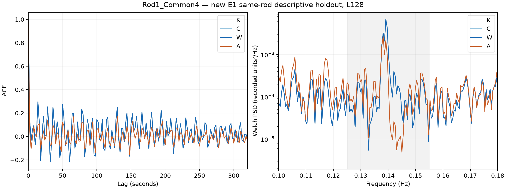
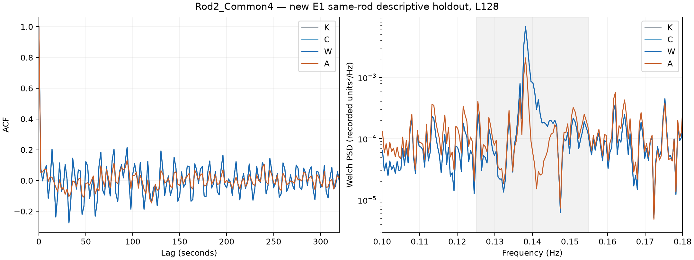

# 新版 E1 同棒白化实验重跑

本次实际使用最新逐层冻结的完整 Urysohn K/C/W/A，输入历史统一 128 点（256 秒）。复用刚完成的新版源棒训练并重新预测：Rod1 模型评分 Rod1，Rod2 模型评分 Rod2；模型、配方、route 不根据白化或尾段改动。

训练源码与 release 绑定为 `a1109dc5d5e3b6bc0f00ed018b4399ad87b2bf3691f6790c5d881e1b48b3f507`。原轻量白化实验的同棒划分保留：源棒验证前半段用于描述性验证，中间 257 行隔离，尾段为 descriptive holdout。因为配方沿用新版 E1 的源训练选择，这次前半验证也不重新选择 H/alpha。A 残差历史分别为 Rod1 96 点、Rod2 32 点。

| 同棒模型 | 原训练行数 | 本次验证 | 隔离 | 本次尾段 |
|---|---:|---:|---:|---:|
| Rod1_Common4 | 15431 | 1800 | 257 | 1544 |
| Rod2_Common4 | 16092 | 1883 | 257 | 1626 |

## 各阶段结果

| arm | split | stage | route | RMSE | E160 | E900 | 约7秒频带能量 | lag7 | lag14 |
|---|---|---|---|---:|---:|---:|---:|---:|---:|
| Rod1_Common4 | validation | K | ADMITTED | 0.00747041 | 2.4197 | 3.4592 | 1.445e-05 | 0.3029 | 0.2749 |
| Rod1_Common4 | validation | C | BYPASSED | 0.00747041 | 2.4197 | 3.4592 | 1.445e-05 | 0.3029 | 0.2749 |
| Rod1_Common4 | validation | W | BYPASSED | 0.00747041 | 2.4197 | 3.4592 | 1.445e-05 | 0.3029 | 0.2749 |
| Rod1_Common4 | validation | A | ADMITTED | 0.00647787 | 0.2142 | 0.5172 | 6.05e-06 | 0.0697 | 0.0482 |
| Rod1_Common4 | descriptive_holdout | K | ADMITTED | 0.00730341 | 2.0305 | 3.5640 | 1.253e-05 | 0.2966 | 0.2529 |
| Rod1_Common4 | descriptive_holdout | C | BYPASSED | 0.00730341 | 2.0305 | 3.5640 | 1.253e-05 | 0.2966 | 0.2529 |
| Rod1_Common4 | descriptive_holdout | W | BYPASSED | 0.00730341 | 2.0305 | 3.5640 | 1.253e-05 | 0.2966 | 0.2529 |
| Rod1_Common4 | descriptive_holdout | A | ADMITTED | 0.00657689 | 0.6537 | 1.1908 | 7.867e-06 | 0.0980 | 0.1351 |
| Rod2_Common4 | validation | K | ADMITTED | 0.00679763 | 1.7433 | 3.3177 | 1.169e-05 | 0.2763 | 0.1790 |
| Rod2_Common4 | validation | C | BYPASSED | 0.00679763 | 1.7433 | 3.3177 | 1.169e-05 | 0.2763 | 0.1790 |
| Rod2_Common4 | validation | W | ADMITTED | 0.00679763 | 1.7433 | 3.3177 | 1.169e-05 | 0.2763 | 0.1790 |
| Rod2_Common4 | validation | A | ADMITTED | 0.00609675 | 0.3571 | 0.9144 | 4.809e-06 | 0.0531 | -0.0212 |
| Rod2_Common4 | descriptive_holdout | K | ADMITTED | 0.00680923 | 1.5229 | 3.1031 | 1.219e-05 | 0.2027 | 0.1046 |
| Rod2_Common4 | descriptive_holdout | C | BYPASSED | 0.00680923 | 1.5229 | 3.1031 | 1.219e-05 | 0.2027 | 0.1046 |
| Rod2_Common4 | descriptive_holdout | W | ADMITTED | 0.00680923 | 1.5229 | 3.1031 | 1.219e-05 | 0.2027 | 0.1046 |
| Rod2_Common4 | descriptive_holdout | A | ADMITTED | 0.00624687 | 0.3775 | 0.8534 | 5.481e-06 | 0.0210 | -0.0894 |

## A 相对 W 的变化

| arm | split | RMSE降幅 | E160降幅 | E900降幅 | 频带能量降幅 | 最终峰周期 |
|---|---|---:|---:|---:|---:|---:|
| Rod1_Common4 | validation | 13.29% | 91.15% | 85.05% | 58.14% | 7.136s |
| Rod1_Common4 | descriptive_holdout | 9.95% | 67.80% | 66.59% | 37.20% | 7.237s |
| Rod2_Common4 | validation | 10.31% | 79.51% | 72.44% | 58.88% | 7.262s |
| Rod2_Common4 | descriptive_holdout | 8.26% | 75.21% | 72.50% | 55.05% | 7.237s |

正降幅表示指标减少，负值表示恶化。E160/E900 是 lags 1–160/900 的 ACF 平方和，不是误差能量或统计显著性。lag7=14秒，lag14=28秒，不等同于约7秒谱峰。

## 固定 residual probe

固定 H=32、alpha=1；分别仅拟合新版各阶段封存 outer-OOF 的残差。每折/实体/缺行均清空特征历史，未用部署模型的训练内误差，未用验证或尾段标签拟合 probe；该 probe 是诊断模型，其拟合与主模型零重训分别计数。

| arm | split | stage | 成熟历史 probe R² |
|---|---|---|---:|
| Rod1_Common4 | validation | K | 0.1913 |
| Rod1_Common4 | validation | C | 0.1899 |
| Rod1_Common4 | validation | W | 0.1912 |
| Rod1_Common4 | validation | A | -0.0628 |
| Rod1_Common4 | descriptive_holdout | K | 0.1371 |
| Rod1_Common4 | descriptive_holdout | C | 0.1401 |
| Rod1_Common4 | descriptive_holdout | W | 0.1385 |
| Rod1_Common4 | descriptive_holdout | A | -0.0581 |
| Rod2_Common4 | validation | K | 0.1678 |
| Rod2_Common4 | validation | C | 0.1678 |
| Rod2_Common4 | validation | W | 0.1624 |
| Rod2_Common4 | validation | A | -0.0773 |
| Rod2_Common4 | descriptive_holdout | K | 0.1264 |
| Rod2_Common4 | descriptive_holdout | C | 0.1264 |
| Rod2_Common4 | descriptive_holdout | W | 0.1145 |
| Rod2_Common4 | descriptive_holdout | A | -0.1027 |

## 解释与范围

这是新版 E1 的同棒白化重跑，与原 raw-history Ridge 的模型不同，不能把数值差异只归因于输入长度。原 Rod1_AllLegal 不在当前新版 E1 的注册四通道模型中，本次未用旧 Ridge 代替它，也未宣称该 arm 已完成。正式跨棒 E1 结果与协议保持独立封存。

本次另调用当前 release 的 v0.6 观测合同、目标时间索引审计和分段 PSD/ACF/PACF；只读，不改变标签、评分行、route、prediction rounding。对原始记录的单位/ADC 没有外部核实；2秒采样来自注册约定而非独立时间戳校验。

历史尾段已被查看，本次为回顾性诊断，不是独立确认性试验。Welch 按原实验固定 fs=0.5Hz、nperseg=1024、noverlap=512、频带0.125–0.155Hz。此频带与上一轮跨棒 v0.6 表的0.133–0.153Hz不同，不能直接横比能量占比。验证/尾段仅约两个 Welch 窗口；900阶相关有效对数有限。ACF图上的点态95%参考带只作描述，未用作验收或多重检验。指标下降不等于证明白噪声，也不识别7秒峰的物理来源。

## 图

