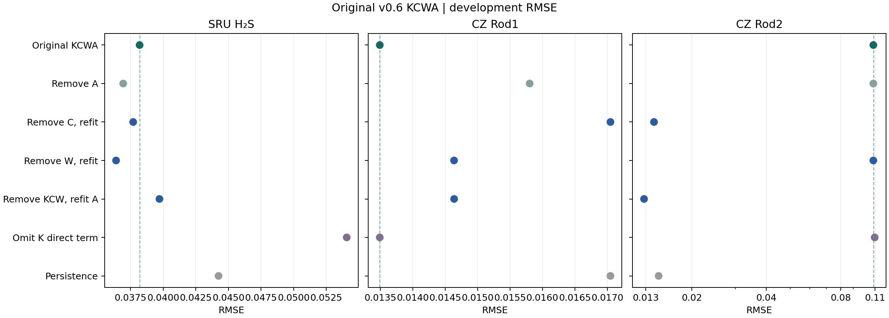
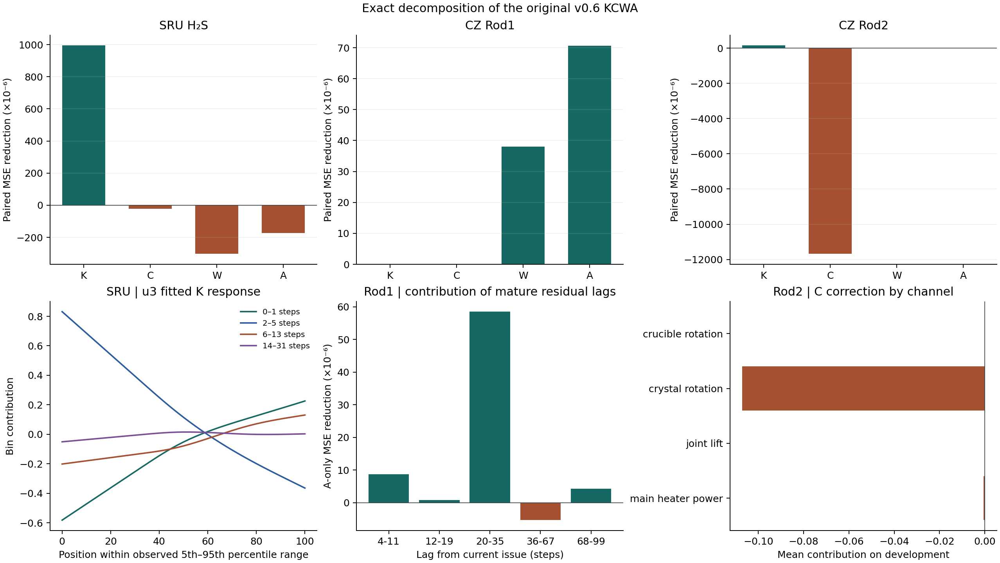
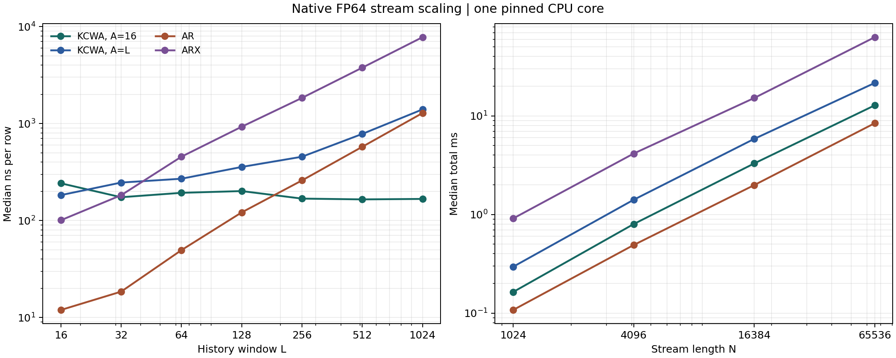

# 10 月原版 v0.6 KCWA 的消融、解释度与时间复杂度

三套数据统一使用 (H=0,D=4,L=128)。过程量可见至 (t)，真值可见至 (t-4)。SRU H₂S、CZ Rod1 和 CZ Rod2 的开发评分点数分别为 2,016、4,021 和 4,125。完整模型逐点复现上一轮原版 KCWA 的预测。全部消融使用相同的开发评分行，并通过未来过程量与未成熟真值扰动检查。

## 消融

| 对照 | SRU H₂S | CZ Rod1 | CZ Rod2 |
| --- | ---: | ---: | ---: |
| 持续值 | 0.044241 | 0.017049 | 0.014664 |
| 冻结 K | 0.035900 | 0.017049 | 0.014502 |
| 冻结 KC | 0.035807 | 0.017049 | 0.108377 |
| 冻结 KCW（去 A） | 0.036939 | 0.015804 | 0.108377 |
| **完整 KCWA** | **0.038195** | **0.013493** | **0.108377** |
| 去 C，重训下游 | 0.037704 | 0.017049 | 0.014042 |
| 去 W，重训 A | 0.036392 | 0.014638 | 0.108377 |
| 去 KCW，在持续值上重训 A | 0.039714 | 0.014639 | 0.012800 |
| 去 K 直接加项，保留 K 表征 | 0.054060 | 0.013493 | 0.109757 |

冻结逐层对照沿用完整模型的权重与路由。结构消融在原训练块上重跑受影响的配方选择、交叉拟合和接纳规则。只去 K 直接加项的对照保留 C、W 的原输入坐标，并用该对照实际发出的上游预测生成 A 的成熟残差。置信区间为 2,500 次成对循环区块重采样的描述性区间，区块长度 192。

- **SRU** 的主要收益来自 K。去掉 K 的直接加项使 RMSE 增加 **41.54%**，95% 区间为 [34.26%, 55.96%]。冻结 KC 是逐层对照中误差最低的一档。去 A 和去 W 重训的点估计分别下降 3.29% 和 4.72%，两组区间均跨零。
- **Rod1** 同时受益于 W 和 A。去 A 使 RMSE 增加 **17.13%**，区间为 [13.66%, 20.56%]。去 W 重训 A 使 RMSE 增加 **8.49%**，区间为 [5.46%, 11.33%]。完整模型部署时旁路 C，但在结构上删除 C 会改变训练折中的下游配方及路由，重训后 W 和 A 均旁路。
- **Rod2** 的误差主要来自 C。原版模型从 K 的 0.014502 升到 KC 的 0.108377。去 C 重训下游使 RMSE 降低 **87.04%**，区间为 [86.16%, 87.89%]。在持续值上重训 A 得到 0.012800。

## 解释度

对水平预测做逐点分解 \(\hat y_t=y_{t-4}+\Delta K_t+\Delta C_t+\Delta W_t+\Delta A_t\)。三组预测的最大重构绝对差为 \(5.7\times10^{-14}\)。分别报告水平 \(R^2\)、四步增量 \(R^2\) 以及相对持续值的 MSE 改善。增量 \(R^2\) 用增量本身的方差作分母，持续值改善率用持续值的 MSE 作分母。

| 数据集 | 水平 \(R^2\) | 增量 \(R^2\) | 相对持续值 MSE 改善 | 参考通道 |
| --- | ---: | ---: | ---: | --- |
| SRU H₂S | 0.445427 | 0.254591 | +25.46% | `u3` |
| CZ Rod1 | 0.997644 | 0.372014 | +37.37% | 联合升速 |
| CZ Rod2 | 0.169175 | −53.624630 | −5,362.42% | 联合升速 |

每个模块的误差归因计算为其加项乘以 \(2(y_t-y_{t-4})-(\hat y_t-y_{t-4})\)。四项之和等于相对持续值的逐行平方误差下降。A 的滞后归因另以同一 KCW 输出为起点。解释针对冻结模型与观测通道。

- **SRU** 的 `u3` 是三秩 Urysohn 参考通道。中心化响应在 0–1 步和 2–5 步箱的变化最大，两箱的拟合曲线方向相反。K 的平均 MSE 改善贡献为 \(9.95\times10^{-4}\)，W 和 A 在完整路径中的贡献分别为 \(-3.03\times10^{-4}\) 和 \(-1.72\times10^{-4}\)。
- **Rod1** 的 K 直接输出旁路，W 继续使用保留的联合升速响应作为坐标。A 在距当前发出点 **20–35 步**的成熟残差组贡献最大，对当前 A 的 MSE 下降贡献为 \(5.85\times10^{-5}\)。
- **Rod2** 的 C 项平均偏移为 −0.107667，其中晶转速度一项为 **−0.107160**，约占 99.5%。该通道的四个滞后箱在开发段均有 **100%** 的输入箱均值超出对应训练块的最小至最大范围。训练块上该通道的平均 C 项近零。这个分解定位了冻结模型的外推失效。

## 时间复杂度

### 原生流式推理

令 \(M\) 为过程通道数，\(B_j\) 和 \(m_{x,j}\) 为活跃 K 通道的滞后箱数和幅值基维数，\(p_C\) 为 C 的特征数，\(S_W\) 为 W 的多项式分段数，\(p_A\) 为 A 的残差滞后数。滑动前缀和更新耗时 \(O(M)\)，每个箱均值用两次前缀读取。C 的点积、W 的分段查找和 A 的固定系数点积均计入行成本。

\[
T_{\mathrm{row}}=O\!\left(M+\sum_{j\in\mathrm{active}}B_j m_{x,j}+p_C+S_W+p_A\right),\qquad
S_{\mathrm{online}}=O(ML+L_A+D).
\]

\(L_A\) 是 A 残差缓冲所覆盖的历史。固定特征宽度、箱数与 A 滞后数时，每行计算量对 \(L\) 为常数，整段对行数 \(N\) 为线性。若使用整窗密集残差滞后 \(p_A=L\)，A 的逐行计算量随 \(L\) 线性增长。匹配的稠密 AR 与 ARX 分别为 \(O(L)\) 与 \(O((M+1)L)\) 每行。训练中的稠密岭回归子问题对 \(n\) 行、\(d\) 维特征的常见成本为 \(O(nd^2+d^3)\)。原版拟合还需计入实际候选、时间折和低秩 K 的交替迭代。

### 真实模型实测

服务器为 Intel Xeon Platinum 8352V，在固定 CPU 核 12 上以 GCC 11.4 编译 FP64 单线程内核。时间为 15 次重放的每行平均耗时中位数，含过程历史与成熟残差索引、模型计算和写出预测。原生 C 内核使用真实冻结权重，三套 KCWA 的逐点预测与评分档案最大误差均低于 \(6\times10^{-14}\)。

| 数据集 | KCWA（ns/行） | AR（ns/行） | ARX（ns/行） | 实际 A 滞后数 |
| --- | ---: | ---: | ---: | ---: |
| SRU H₂S | 366.3 | 175.3 | 1470.1 | 64 |
| CZ Rod1 | 253.0 | 137.4 | 882.9 | 96 |
| CZ Rod2 | 173.2 | 119.7 | 1013.3 | 0 |

合成伸缩实验固定过程特征宽度和 K 箱数。固定 \(p_A=16\) 时，\(L=16\) 至 1024 的每行耗时维持在数百 ns 量级。用 \(p_A=L\) 时，从 \(L=128\) 的 357 ns 升到 \(L=1024\) 的 1399 ns。固定 \(L=128,p_A=16\) 时，行数从 1,024 增至 65,536，内核总时间从 0.164 ms 增至 12.81 ms。

### 原版 Python 逐点实现

在同一 CPU 核上执行 SRU 原版 Python `online_a`，128、256、512、1,024 行分别用时 3.021、7.285、20.226、64.639 秒，为 3 次重放的中位数。原版实现每步拼接全部已成熟历史并重新构造状态。仅重建历史的累计工作量就是 \(\Theta(N^2)\)，另有排序、哈希和逐点数据框操作。上表的原生实现使用有界残差环形缓冲，并逐点核对相同预测值。

`ABLATION_SCORES.csv` 保存完整对照及区间，`EXPLANATION_RESULTS.json` 保存各层、通道、幅值曲线和滞后贡献。`COMPLEXITY.json` 与 `REFERENCE_COMPLEXITY.json` 分别保存原生内核与原版 Python 的计时重复。

