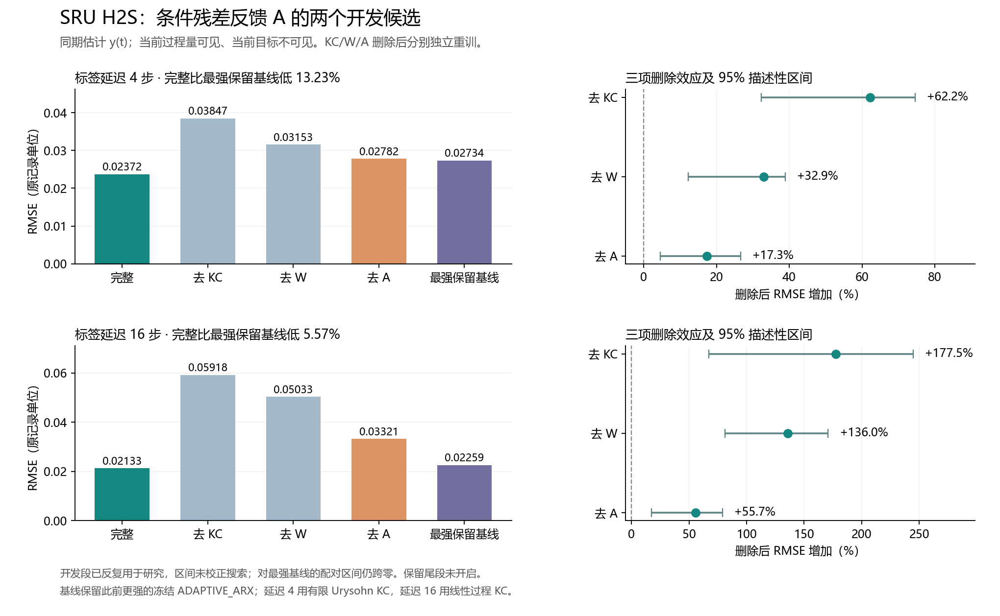

# SRU：条件残差反馈增强 A

V9在H2S同期估计、标签延迟4和16步两个设置中，KC/W/A独立删除效应及全段、固定启动描述性区间均正，完整模型优于17项登记基线和此前已得到的更强冻结基线。这是反复使用SRU开发段后的探索结果，尚无独立保留段确认。本轮最终尾段未读取。

本轮3分支、9设置、45条最终配置、36个最终主模型A政策、9个ADAPTIVE_ARX A政策，实际186次候选A搜索。无新增物理来源或记录；原54对支持修正及旧结果不变。

任务是用当前x(t)、历史过程量和已成熟y估计y(t)，不是预测未来4/16步。4/8/16步是实验标签延迟，未核实为现场仪表时延。原10081点中前6048训练，6048–8063开发，8064–10080保留。本轮仅加载前8064点，旧源不能称新锁箱。

V8增加发行响应q(t)及其1/4/8/16/32步差分和q×差分。V9再加入一条成熟残差r(t-delay)，及r×[q,Δq4,Δq32]，使反馈系数随当前工况和响应变化。V10另测输出链接潜在坐标创新，训练风险仍按物理单位评分。均保留标准化ridge100初始化和成熟stored-phi RLS核心，属于明确结构改进，不是未修改v0.6，也不是阻尼正余弦+AR版本。

两个V9成功设置均选择QC32_RLS、最近512条合法初始化、forget=.999、gain=1。延迟4的KC为有限Urysohn过程响应，延迟16为线性过程响应；两者W为带符号平方根逆链接。不能据此宣称原非线性KC处处有效。

|标签延迟|完整RMSE|保留最强基线RMSE|完整降低%|去KC增加%|去W增加%|去A增加%|
|---|---:|---:|---:|---:|---:|---:|
|4|0.023721836|0.027340221|13.235|62.185|32.924|17.266|
|16|0.021331180|0.022589525|5.570|177.453|135.958|55.682|

增加%=100×(删除后RMSE/完整RMSE−1)。删除后均独立重训及重新选择。

|延迟|对照|全段95%描述性区间|固定启动95%描述性区间|
|---|---|---|---|
|4|no_KC|[32.234870544346066, 74.64886598836594]|[33.07024308457896, 73.18033152504196]|
|4|no_W|[12.15128824480462, 38.94908027362304]|[11.350228363572763, 38.83767782147488]|
|4|no_A|[4.5926768084731275, 26.60233437873895]|[3.3662531516216094, 25.866604512051275]|
|16|no_KC|[67.07813622317457, 244.56177298647853]|[74.05425202485914, 247.9407813959833]|
|16|no_W|[81.086366307059, 170.51043012747522]|[88.25423506146761, 171.28148556265603]|
|16|no_A|[17.41239034203504, 78.94931452285378]|[20.388018139318806, 79.59412111006242]|

2500次配对循环块重采样，块长192；固定启动去掉32+delay−1点。开发段多轮复用，区间未校正搜索次数；不能当独立验证。对最强保留基线的配对区间另存JSON，均值领先不自动代表显著。

|延迟|原报告A对照RMSE|冻结A更新RMSE|在线新A RMSE|在线更新额外降低%|
|---|---:|---:|---:|---:|
|4|0.028278684|0.037584728|0.023721836|36.884|
|16|0.032753567|0.025498573|0.021331180|16.344|

冻结更新仍读取成熟残差特征，仅冻结RLS参数。去A收益混合初始化校准、条件反馈与参数适应，不全是在线更新。延迟16时，冻结更新相对在线完整模型的误差增加区间为[1.876%,34.831%]，固定启动区间也为正；延迟4此区间跨零，不能同样声称稳定的在线更新增益。

|延迟|固定四等分去A增加%（1/2/3/4）|
|---|---|
|4|9.162 / 21.395 / 15.574 / 17.024|
|16|8.505 / 43.217 / 31.000 / 80.476|

四等分仅作固定诊断，不用来选窗或改变总评分。两个候选都四段正，不等于四次独立验证。最强基线相对完整模型的误差增加区间：延迟4为[-0.350%,24.154%]，延迟16为[-18.384%,23.918%]；两者跨零，所以只能称当前开发均值更优。

|分支|延迟|完整RMSE|去A增加%|胜保留强基线且三块区间均正|
|---|---:|---:|---:|---|
|V8 动态响应|4|0.043022551|-35.342|False|
|V8 动态响应|8|0.030970073|-2.144|False|
|V8 动态响应|16|0.027483898|20.830|False|
|V9 条件残差反馈|4|0.023721836|17.266|True|
|V9 条件残差反馈|8|0.030970073|-2.144|False|
|V9 条件残差反馈|16|0.021331180|55.682|True|
|V10 潜在坐标创新|4|0.031569517|-11.885|False|
|V10 潜在坐标创新|8|0.030970073|-2.144|False|
|V10 潜在坐标创新|16|0.027483898|20.830|False|

V8延迟16的A有正作用但落后ADAPTIVE_ARX；延迟4/8未改善。V10潜在坐标延迟4较差、延迟8/16回选物理坐标且等于V8，不算独立复现。V9延迟8也失败。全部阴性保留。

基线包含Persistence、OWN、ARX、逆链接ARX、HGB、SVR、在线ARX及128目标历史/40过程历史扩展，覆盖A的q32及上游7步跨度。ADAPTIVE_ARX获得相同新A家族、折和预算。V9/V10复用V8的16项非ADAPTIVE冻结基线，哈希和预测逐值一致，不能计为重新拟合。此前V6及本轮各分支ADAPTIVE_ARX额外保留：延迟4最强为V6，延迟16为V8。历史PRISM完整模型另外列参考。

独立复核2920个不同支持证明对象、全保存预测误差及重采样区间、代码/源/冻结模型哈希和数值证书。54条主/消融/ADAPTIVE链逐段重放，在9个前缀长度下遮蔽所有未成熟y和未来X，仍重现保存预测；初始化、特征和更新均符合标签成熟限制，无额外拟合。分支检查12/13/15通过（含共用项，不相加作独立新增检查）。

完整内外A支持隔离、至少200条且每系数20条、数值门槛未放宽。设计限制：noA保留阶段分区，重选上游但未把A校准标签追加给W拟合，阶段预算影响消融解释。需结合全训练预算强基线和冻结更新控制。当前结果只限SRU H2S和两个假定延迟。保留段在来源暴露审计和选择冻结前保持封存。

[完整数值与区间](COMBINED_REVIEW.json)；[来源账本快照](SHARED_FINAL_LEDGER_AUDIT.json)。
