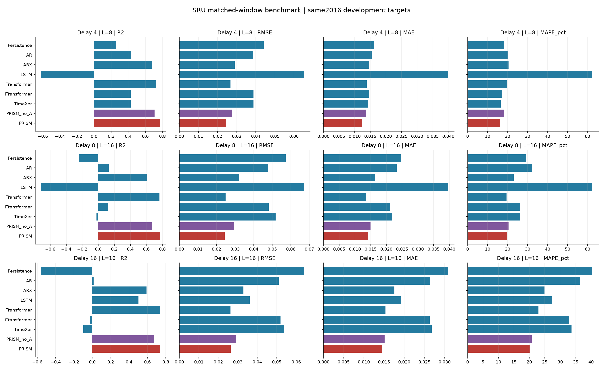
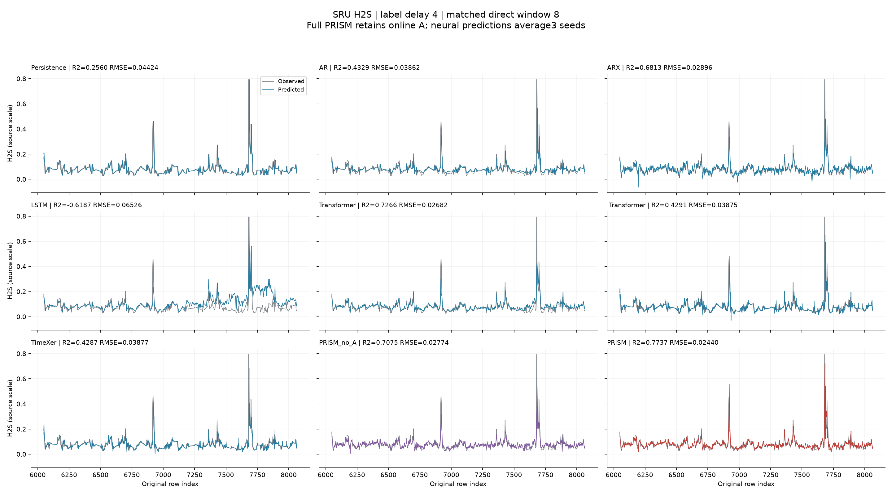
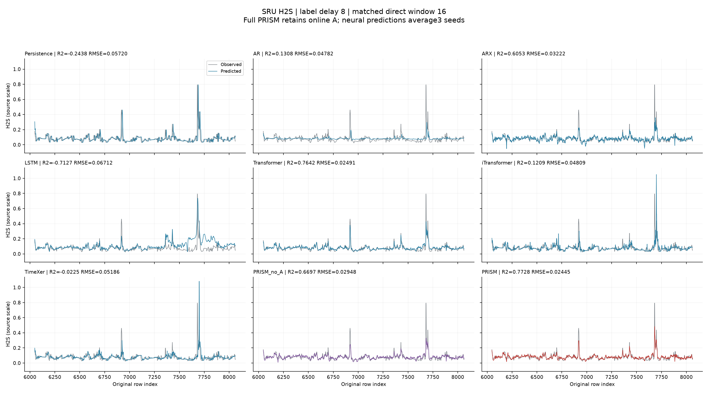
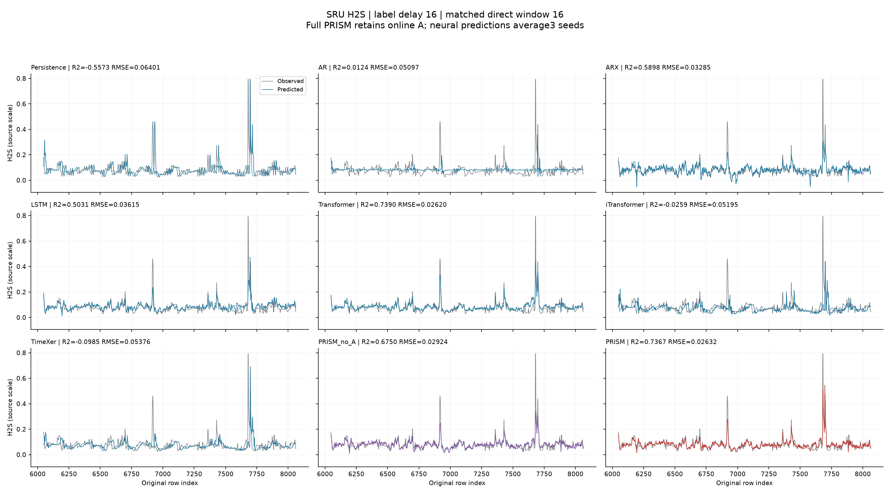

# SRU H2S：基线采用PRISM选定的相同历史窗口

状态：COMPLETED。本轮为新服务器上的再次完整重训。依照用户要求，标签延迟4步的AR、ARX、LSTM、Transformer、iTransformer、TimeXer统一8步历史，延迟8和16步统一16步历史。窗口来自此前完整PRISM训练内选择，未按本轮基线开发结果挑窗口。主表保留完整PRISM在线A，另列相同窗口的no_A与Persistence。旧实验均保留。

## 协议

相同期软测量y(t)，可用X至t、y至t-delay。直接X为x(t-L+1)..x(t)，成熟输出为y(t-delay-L+1)..y(t-delay)。AR用完整L个成熟输出，ARX用完整L个输出及5L个过程输入；神经模型用相同6通道L步序列。Persistence只用最新成熟输出。

训练原始区间[0,6048)，可拟合目标192..6048-delay（含端点）；评估为相同2016个开发目标[6048,8064)。保留尾段[8064,10081)未读取。4/8/16是实验性标签成熟延迟，不是预测未来步长或已确认的分析仪延迟。

只调整基线直接窗口，保留上一轮的训练规则：AR/ARX正则0.01/1/100/1000/10000与level/delta；神经模型宽度32/64、学习率0.001/0.0003两对配置×level/delta，共4项。训练内前向折70%-85%及85%-100%，继续使用保守隔离128+delay步，保持训练/评分目标日期不随本轮短窗口改变。最多80epoch、patience12、batch256；最终epoch为选中两折epoch的中位数。训练内选择种子20261023，最终种子0/1/2；主表为三种子逐点均值，单种子指标与标准差另存。固定512推理批量，尾块补零后丢弃填充结果。

完整PRISM直接重放此前冻结的L8/L16/L16模型，完整预测与上一轮一致；没有重新训练或重新选A。相同窗口no_A使用原候选的冻结模型，因此延迟4步no_A由此前独立选中的L16改为匹配完整PRISM的L8。其余no_A不变。每个PRISM过程响应仍由其模型结构压缩，不把压缩特征称为L个独立系数。

本轮统一的是直接历史跨度和标签可用性。PRISM仍保留分阶段训练、已有窗口搜索与完整在线A；成熟残差、发行预测及RLS状态可间接依赖更早数据。其他模型开发段权重固定，不能将本表称为完全相同总记忆、训练预算或在线更新预算。

## 环境与校验

按用户再次明确要求，在connect.westb.seetacloud.com:13762的新RTX4090实例独立重新拟合全部基线，前一轮RTX5090结果原样保留。本轮沿用已审计的严格FP32后端：关闭TF32、MHA fastpath和非math的SDPA路径；模型、优化候选、训练内折、随机种子及数值容限均保持不变。训练前用旧L128/seed0冻结权重与CPU FP64参考核对四类神经网络，通过原rtol3e-5/atol2e-6容限，见MIGRATION_CHECK.json。

本轮没有沿用已有基线权重，而是重新做训练内选择及三个种子的最终拟合。使用相同种子是计算复跑的定义，不构成新的独立随机种子样本；数据仍是同一个开发区间。仅保留完整PRISM及同窗口no_A的既有冻结权重。与上一轮相同窗口结果的逐模型比较见results/comparison_with_first_matched.csv；硬件变化和数值舍入可使神经训练轨迹及选中配置变化。

全部15组新基线拟合冻结后才生成本轮新模型开发预测。PRISM未来X/未成熟y扰动及7个前缀通过1e-12检查，36条神经种子链通过原容限与批量前缀检查；独立重算指标并核对CSV/Parquet、种子均值、线性模型和完整PRISM旧预测。

开发段此前已多轮使用，本结果不是独立最终测试或普遍优越性证明。指标在源数据原尺度计算，无裁剪。MAPE百分数，仅排除abs(y)<=1e-8并计数，另有sMAPE、WAPE和bias。

## 完整指标

|标签延迟|历史窗口|模型|R²|RMSE|MAE|MAPE (%)|
|---:|---:|---|---:|---:|---:|---:|
|4|1|Persistence|0.255977|0.04424100|0.01626614|18.1853|
|4|8|AR|0.432947|0.03862277|0.01558786|20.2913|
|4|8|ARX|0.681251|0.02895716|0.01468801|20.5213|
|4|8|LSTM|-0.618696|0.06525508|0.03993443|62.3971|
|4|8|Transformer|0.726580|0.02681927|0.01385481|19.7361|
|4|8|iTransformer|0.429074|0.03875445|0.01465536|17.0490|
|4|8|TimeXer|0.428667|0.03876828|0.01434235|16.5466|
|4|8|PRISM_no_A|0.707517|0.02773843|0.01358022|18.2241|
|4|8|PRISM|0.773695|0.02439936|0.01242093|16.1008|
|8|1|Persistence|-0.243807|0.05720162|0.02458711|29.2873|
|8|16|AR|0.130843|0.04781683|0.02324039|32.1891|
|8|16|ARX|0.605343|0.03222121|0.01647951|23.0094|
|8|16|LSTM|-0.712658|0.06712233|0.03962963|62.3587|
|8|16|Transformer|0.764194|0.02490628|0.01358174|19.4243|
|8|16|iTransformer|0.120877|0.04809020|0.02117907|26.2375|
|8|16|TimeXer|-0.022482|0.05186322|0.02176776|26.3647|
|8|16|PRISM_no_A|0.669651|0.02947936|0.01497398|20.4975|
|8|16|PRISM|0.772797|0.02444773|0.01419648|19.7768|
|16|1|Persistence|-0.557305|0.06400569|0.03086561|40.3741|
|16|16|AR|0.012419|0.05097042|0.02633743|36.4941|
|16|16|ARX|0.589809|0.03284921|0.01758961|24.8925|
|16|16|LSTM|0.503119|0.03615414|0.01915156|27.2889|
|16|16|Transformer|0.738980|0.02620405|0.01533608|22.9597|
|16|16|iTransformer|-0.025920|0.05195036|0.02631400|32.8276|
|16|16|TimeXer|-0.098528|0.05375727|0.02679925|33.6790|
|16|16|PRISM_no_A|0.675039|0.02923800|0.01514591|20.7846|
|16|16|PRISM|0.736667|0.02631989|0.01459136|20.1881|

## 产物

- [完整指标](results/metrics.csv)、[逐种子指标](results/metrics_by_seed.csv)、[种子均值/标准差](results/metrics_seed_mean_std.csv)。
- [54432行逐点预测](results/point_predictions_long.csv)、[Parquet长表](results/point_predictions_long.parquet)。
- [延迟4逐点](results/point_predictions_D4.csv)、[延迟8逐点](results/point_predictions_D8.csv)、[延迟16逐点](results/point_predictions_D16.csv)。
- [与旧固定128步结果的描述性比较](results/comparison_with_fixed128.csv)、[训练时间与配置](results/runtime_and_selection.csv)。
- [预登记](REGISTRATION.json)、[全部冻结门槛](ALL_FITS_FROZEN.json)、[独立复核](results/INDEPENDENT_VERIFICATION.json)、[迁移数值检查](MIGRATION_CHECK.json)。runs/包含全部新权重、内层候选分数及轨迹，prism_reference/包含原模型和完整候选收据；没有重新拟合PRISM。

## 复现

原科学Python3.10环境用于prism_replay.py，Torch/Python3.12环境用于其他脚本。包内不附完整环境，精确版本保存在REGISTRATION.json及原参考登记。恢复原字节后，读取已有冻结模型可执行prism_replay.py4/8/16及experiment.py evaluate；不需要重训。

新目录重训需保留全部源码、data/、previous/及prism_reference/，先experiment.py prepare和smoke，并完成环境迁移核对，再launch.py。launch用两个GPU工作进程，每进程3个CPU线程并使用MPS，待全部拟合冻结后重放PRISM和评价。report.py只独立复核及绘图。模型实现沿用作者官方TimeXer仓库固定提交76011909357972bd55a27adba2e1be994d81b327，两篇论文均为2024年，不宣称截至2026年全部最新SOTA。

