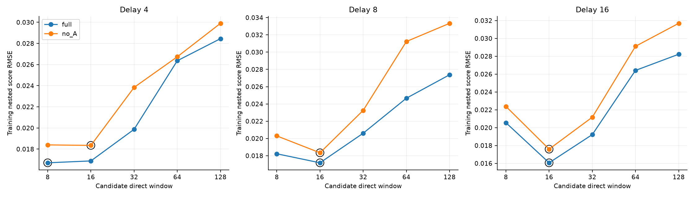
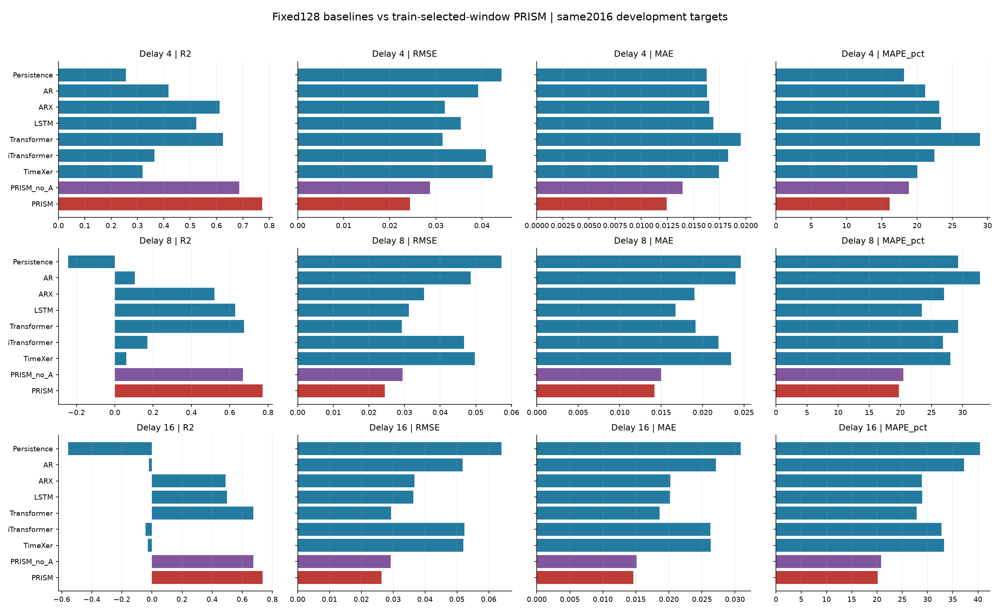
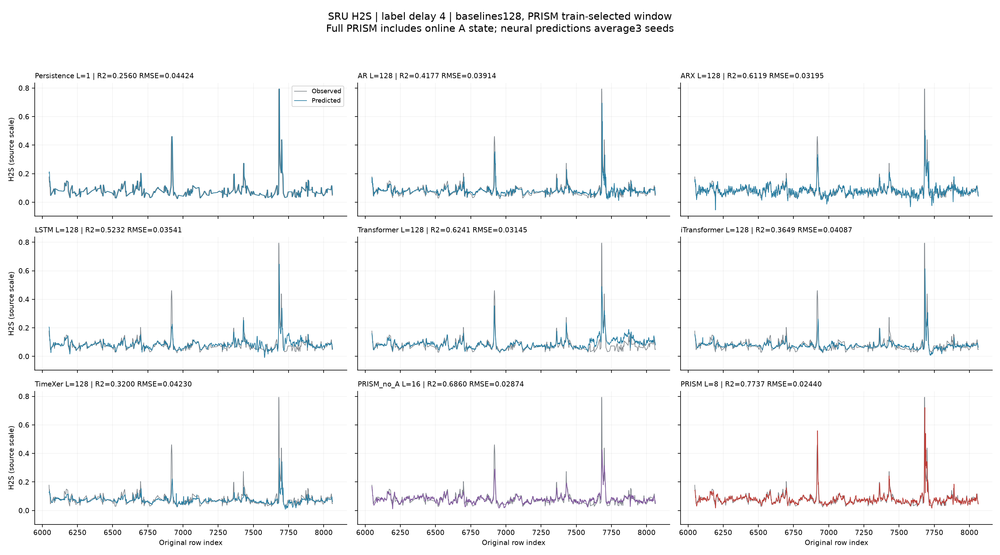
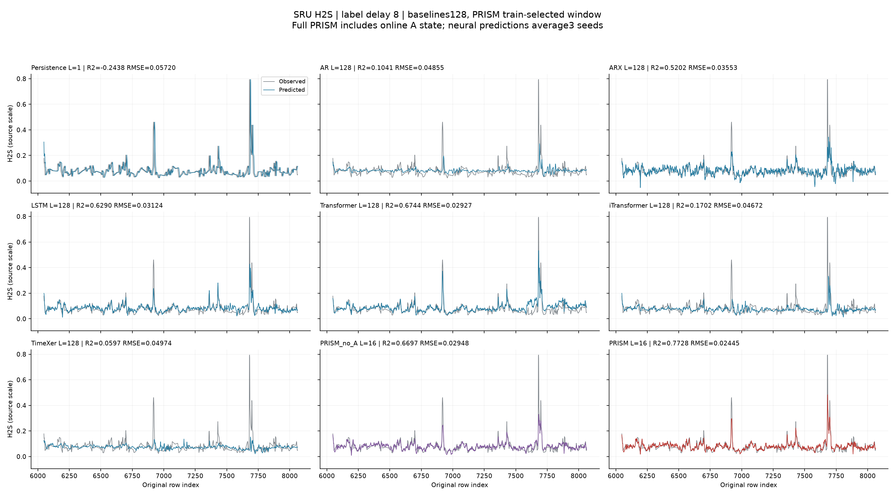

# SRU H2S：固定128步基线与自选窗口 PRISM

状态：COMPLETED。按用户最新要求，AR、ARX、LSTM、Transformer、iTransformer、TimeXer 保留上一轮固定128步结果；PRISM 将直接窗口纳入模型选择，在8、16、32、64、128中按训练内评分选择。完整在线A保留在主表；no_A独立选窗。Persistence只使用最新成熟标签。

## 窗口选择与数据边界

数据、代码分支和基线权重沿用已核验的最新SRU H2S分支。训练原始区间 `[0,6048)`；同样的2016个开发目标 `[6048,8064)`。保留尾段 `[8064,10081)` 未读取。delay4/8/16为实验性标签成熟延迟，不是预测步长或已确认的分析仪延迟。预测y(t)可用X至t、y至t-delay。

候选L决定X的当前至过去L-1步、y的t-delay至t-delay-L+1。原KC结构可选当前响应/历史响应均值、两点输出端点0/L-1或不使用输出状态；不把压缩后的两个端点伪称L个独立系数。改变L同时改变响应记忆和端点，不是只截短一个固定128模型。完整A还可使用发行预测、成熟残差及递归参数状态，其间接历史可能超过直接窗口L。

15个delay×L候选组各自独立训练full和no_A，共30套冻结模型。上游拟合目标固定 `[192,3328)`；训练内A校准段固定 `[3328+128+2*delay,6048-delay+1)`。所有窗口使用保守统一隔离127+delay步，使窗口候选的拟合/评分日期、嵌套折和冷启动一致。每个外层校准块.6-.75/.75-.9/.9-1均去掉32+delay-1个冷启动位置；完整候选评分索引保存在每个FROZEN.json，选择阶段逐项验证相同。

每个L沿用原KC/W/A端到端训练内选择、273项A策略候选、200样本/20样本每系数支持门槛与FP64数值证书。跨窗口按选中完整结构的joint selection_MSE最小选窗，平分时选更短L；full和no_A分别选择。A未被接纳时使用父模型风险。所有候选和窗口在打开本轮开发数据数值前冻结，开发RMSE不参与选窗。L128重复训练的KCW选择及完整A父/子风险与上一轮一致，作为重训一致性锚点。

其他基线直接复用已冻结的逐点预测，逐值一致，未因本次PRISM结果重新挑参；神经预测仍为种子0/1/2算术均值。可复现的上一轮完整源代码、权重、账本和环境记录随包保存在baseline_reference/SRU_BASELINES_L128_20261023.tar.gz，SHA256为ca4d91e9fbcee61311ab6719ef82675ecf18efc367876aaca6f22198252f2fda。

本轮比较的是“基线固定128、PRISM训练内自选窗口且保留在线A”，窗口搜索预算和在线更新预算有差异。开发段此前已多轮使用；不能称为新的独立最终测试，也不能由这张表证明普遍优越性。两个早先实验均原样保留。

## 完整指标

|标签延迟|模型|直接窗口|R²|RMSE|MAE|MAPE (%)|
|---:|---|---:|---:|---:|---:|---:|
|4|Persistence|1|0.255977|0.04424100|0.01626614|18.1853|
|4|AR|128|0.417716|0.03913804|0.01628300|21.1745|
|4|ARX|128|0.611916|0.03195175|0.01650630|23.1597|
|4|LSTM|128|0.523250|0.03541418|0.01688490|23.4390|
|4|Transformer|128|0.624056|0.03144801|0.01951195|28.9164|
|4|iTransformer|128|0.364933|0.04087346|0.01830657|22.4660|
|4|TimeXer|128|0.319985|0.04229520|0.01743004|20.0657|
|4|PRISM_no_A|16|0.685965|0.02874225|0.01395981|18.8350|
|4|PRISM|8|0.773695|0.02439936|0.01242093|16.1008|
|8|Persistence|1|-0.243807|0.05720162|0.02458711|29.2873|
|8|AR|128|0.104061|0.04854795|0.02398663|32.7847|
|8|ARX|128|0.520239|0.03552584|0.01900532|27.0288|
|8|LSTM|128|0.629005|0.03124036|0.01671374|23.4607|
|8|Transformer|128|0.674399|0.02926676|0.01913626|29.3036|
|8|iTransformer|128|0.170154|0.04672297|0.02192580|26.8277|
|8|TimeXer|128|0.059668|0.04973618|0.02344616|28.0284|
|8|PRISM_no_A|16|0.669651|0.02947936|0.01497398|20.4975|
|8|PRISM|16|0.772797|0.02444773|0.01419648|19.7768|
|16|Persistence|1|-0.557305|0.06400569|0.03086561|40.3741|
|16|AR|128|-0.020657|0.05181693|0.02713781|37.2148|
|16|ARX|128|0.489402|0.03664976|0.02021725|28.9089|
|16|LSTM|128|0.497850|0.03634533|0.02014149|28.9705|
|16|Transformer|128|0.673346|0.02931403|0.01859624|27.8824|
|16|iTransformer|128|-0.042381|0.05236546|0.02629857|32.7557|
|16|TimeXer|128|-0.027702|0.05199544|0.02635035|33.3019|
|16|PRISM_no_A|16|0.675039|0.02923800|0.01514591|20.7846|
|16|PRISM|16|0.736667|0.02631989|0.01459136|20.1881|

指标在原始数据尺度计算，无裁剪。MAPE以百分数输出，仅排除abs(y)<=1e-8并记录数量；另有sMAPE、WAPE和bias。

## 产物与复现

- [选窗候选分数](WINDOW_CANDIDATES.csv)、[最终选窗与结构](results/selected_windows.csv)、[冻结门槛](ALL_SELECTIONS_FROZEN.json)、[预登记](REGISTRATION.json)。
- [全部指标](results/metrics.csv)、[54432行逐点长表](results/point_predictions_long.csv)、[Parquet长表](results/point_predictions_long.parquet)。
- [delay4逐点](results/point_predictions_D4.csv)、[delay8逐点](results/point_predictions_D8.csv)、[delay16逐点](results/point_predictions_D16.csv)。
- [PRISM与固定128描述性对照](results/prism_vs_fixed128.csv)，RMSE_change_pct负数代表本轮误差更低；结构选择也会变化，不是严格单因素效应。
- [独立复核](results/INDEPENDENT_VERIFICATION.json)；audits/内有全部选中模型未来X/未成熟y扰动及前缀一致性检查，误差容限1e-12且无新增拟合。
- runs/保存全部30套PRISM权重及所有KCW/A候选账本；基线逐种子指标直接随原文件保留。

在空结果目录保留源码、data/及baseline_reference/，原科学计算环境执行 `prism_search.py prepare`、`prism_search.py smoke`、`launch.py`。launch用3个单线程CPU工作进程训练，先冻结全部候选，再选窗，再评估；GPU无需重训。现有冻结模型可仅运行 `prism_search.py evaluate 4/8/16`。report.py只聚合、独立复核和绘图，不重新拟合。

iTransformer与TimeXer采用作者官方TimeXer仓库提交76011909357972bd55a27adba2e1be994d81b327实现，两篇论文均为2024年；不是截至2026年最新SOTA声明。所有文件校验和见SHA256SUMS.json。

